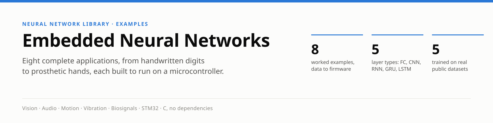
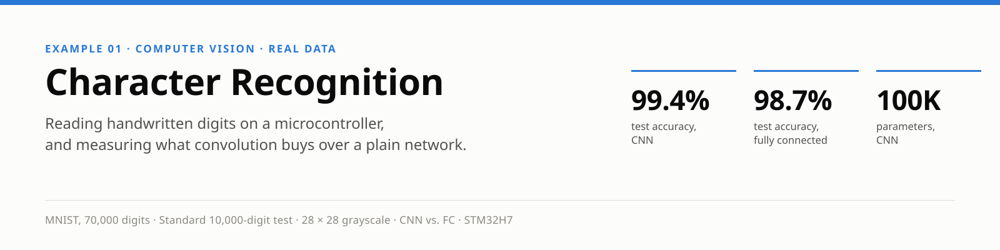
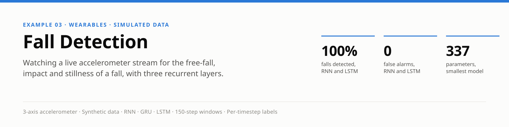
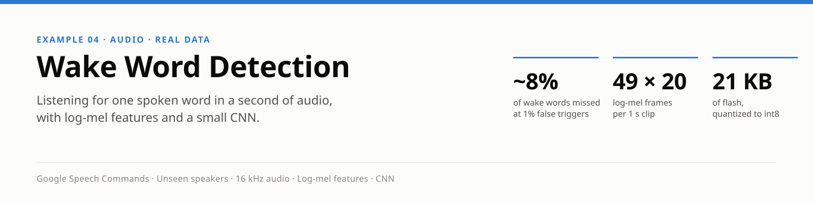
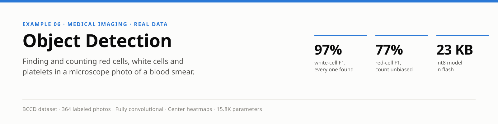
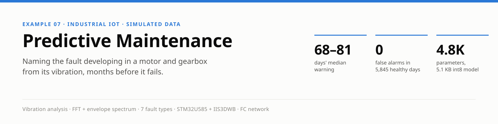
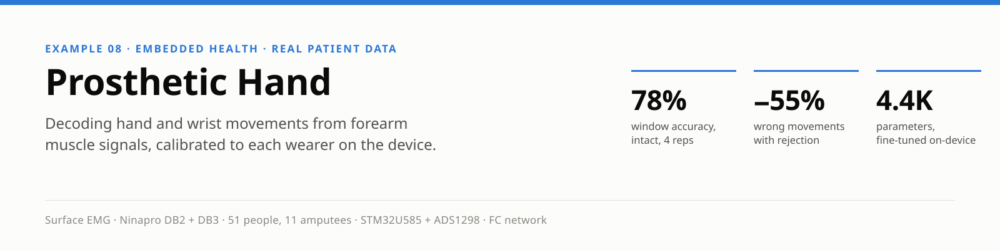

  

Eight self-contained examples of building, training and evaluating a network with this library, each written up as a short technical paper: the application, the device it would run on, the data, the method, measured results, how it fits on a microcontroller, and its limitations. Each has its own Makefile (`cd examples/<name> && make`, which builds the shared library from the top-level Makefile as needed) and generates, simulates or downloads its own training data.

Read in order, they also tell a story. Each example needs a little more memory, or a little more realism, than the last, and the layer type tracks that escalation. The last two turn it around: their networks are among the simplest in the set, because the work has moved into a signal-processing front end and into what each input is compared against — the same machine's own past, or the same wearer's own calibration.

| # | Example | Layer type | Task | Parameters |
|---|---|---|---|---|
| 1 | [Character recognition](character_recognition/README.md) | CNN, with a plain FC baseline | Read a handwritten digit from a 28×28 image | 100K (CNN) / 109K (FC) |
| 2 | [Gesture recognition](gesture_recognition/README.md) | RNN | Tell four gestures apart from a 32-sample burst of accelerometer readings | 388 |
| 3 | [Fall detection](fall_detection/README.md) | RNN, GRU and LSTM, compared | Watch a continuous accelerometer stream and flag a fall, sample by sample | 337 / 977 / 1,297 |
| 4 | [Wake word detection](wake_word_detection/README.md) | CNN, with a GRU baseline | Decide whether a second of real speech is the wake word | 14.8K (CNN) / 5,121 (GRU) |
| 5 | [Image classification](image_classification/README.md) | CNN | Tell a cat from a dog in an ordinary photo | 25K |
| 6 | [Object detection](object_detection/README.md) | Fully convolutional CNN | Find and count every red cell, white cell and platelet in a blood smear | 16K |
| 7 | [Predictive maintenance](predictive_maintenance/README.md) | FC, behind an FFT front end | Name the fault developing in a machine from its vibration, months before it fails | 4,792 |
| 8 | [Prosthetic hand](prosthetic_hand/README.md) | FC, behind an EMG front end, fine-tuned on the device | Decode hand and wrist movements from forearm muscle signals | 4,423 |

---

Recognizes handwritten digits (MNIST), the "hello world" of embedded vision and the network behind this library's own STM32H7 hardware demo. It trains a convolutional network and a plain fully-connected one on the same data and scores both with the same test program, so what convolution buys is measured rather than assumed: **99.41% against 98.71%** (the reference model of each; the CNN's six runs scored 99.29–99.42%) on MNIST's standard 10,000-digit test set, with about the same number of parameters.

Classifies a short burst of 3-axis accelerometer readings as still, shake, tilt left or tilt right — the model behind flick-to-wake and tilt-to-control features on wearables and remotes. A recurrent layer carries what it has seen in a hidden state, one sample at a time, so the window never has to be stored. Training data is synthesized on the fly; a **388-parameter** network classifies **all 200 test windows** correctly, each by its eighth sample.

Continuously monitors a simulated accelerometer stream for a fall — a brief free fall, an impact, then a long stillness — and labels every timestep, as a fall-detection pendant must. It trains a plain RNN, a GRU and an LSTM on identical data and measures each over twenty runs: **all three caught every fall with no false alarms, every time** — the RNN trains fastest, the GRU is the most exact timestep by timestep.

The always-on listener in front of a voice-controlled device: each second of real speech from Google's Speech Commands becomes 49 frames of log-mel energies (`audio_features.[ch]`, shared and firmware-ready), which a small CNN reads as one 49 × 20 image to decide whether it was the wake word, "marvin". Tested on speakers it never trained on, with its threshold set on validation data, it **misses about 5% of wake words at under 1% false triggers** per clip. On a continuous 5.7-hour stream of the same test speech, scanned every 100 ms the way a listener runs, it catches about 90% of wake words at 6–8 false wake-ups per hour, after training on windows cut from runs of words; trained on whole clips alone, it woke falsely dozens to hundreds of times an hour. Confirming with a small GRU over three windows in a row brings it under one false wake-up per hour, catching about four wake words in five. A GRU baseline a third its size misses about 9% at 1% false triggers per clip.

The decision a camera-equipped pet door makes on its own microcontroller: cat or dog. A 25K-parameter CNN trained on about 23,000 ordinary photos from two public datasets, preprocessed by the same code that would run on the device, scores **86% on a balanced test set** — and fits in 36 KB of flash quantized to int8. Accuracy is broken down per breed, all 37 of them.

Finds and counts the red cells, white cells and platelets in a microscope photo of a blood smear, the job of a handheld blood analyzer. Instead of boxes, the network outputs one coarse heatmap per class whose peaks mark cell centers, so detection needs no change to the library. It finds **every labeled white cell** in the test set, with F1 of 77% on red cells and 72% on platelets against labels that themselves miss many cells.

Watches a motor and gearbox through an accelerometer and names which of seven faults is developing — imbalance, misalignment, looseness, two bearing defects, a damaged gear tooth, failing lubrication — while a traditional vibration alarm still reads normal. FFTs turn each snapshot into a frequency fingerprint, compared with the one the machine had when installed. On 140 simulated machines run to failure: **a median 68 to 81 days' warning**, and no false alarms.

Turns the electrical activity of the forearm muscles, picked up by 8 electrodes in a prosthesis socket, into commands for a powered hand and wrist. A shared model trained on 28 people is fine-tuned to each new wearer **on the device** from under a minute of calibration, and tested on real recordings from 8 intact subjects and 11 amputees against the classifier commercial controllers use. Confidence-based rejection **cuts the hand's wrong movements by more than half**.

---

The figures throughout are generated by the scripts in [`tools/docs/`](../tools/docs/README.md).
