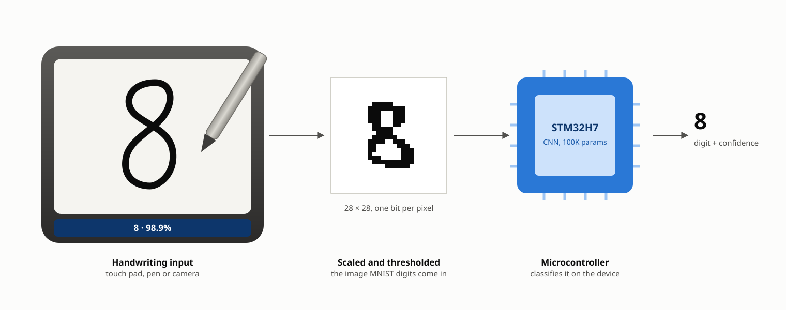
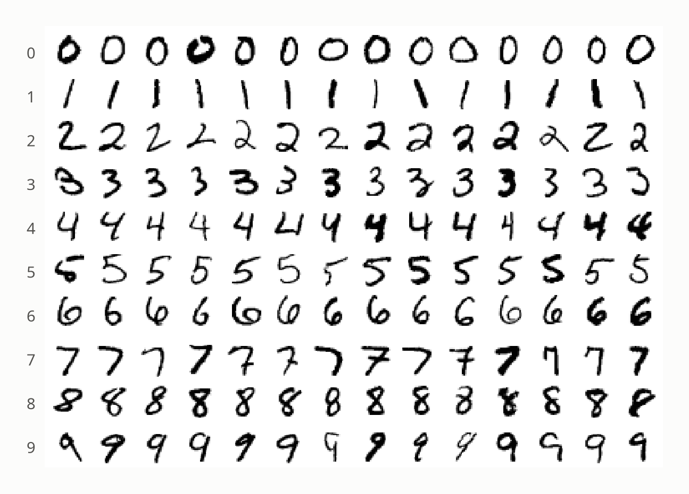
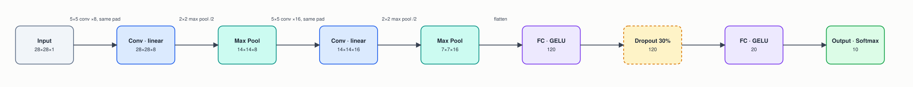
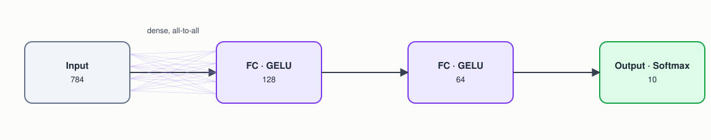
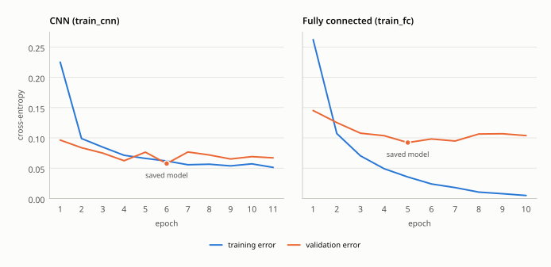
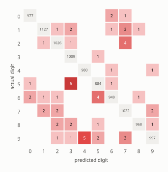
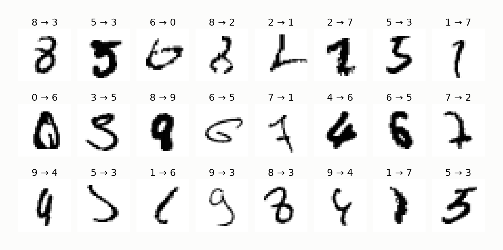
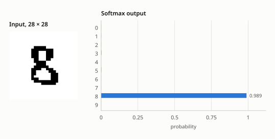

<p align="center">
  
</p>

> **Abstract.** Turning a small handwritten image into a digit is the "hello world" of embedded vision, and the same model shape reads handwritten amounts, form fields and dials on devices with no network connection. This example trains two networks on the same MNIST digits — a convolutional network (CNN) and a plain fully-connected one — and evaluates both with the same test program on MNIST's standard 10,000-digit test set, written by different people than the training digits, so what the convolution layers buy is measured rather than assumed. Over five training runs each, the CNN scores 99.29–99.42% (median 99.39%) and the fully-connected network 98.66–98.81% (median 98.71%): about half the mistakes, with about the same number of parameters (100K and 109K) but eight times the arithmetic per digit for the CNN. Quantized to 8-bit integers, neither loses measurable accuracy, and the CNN fits in 99 KB of flash. The library behind it has run this task live on an STM32H7 microcontroller.

| | |
|---|---|
| **Task** | 10-way classification of a 28 × 28 handwritten digit |
| **Data** | MNIST: 60,000 training digits (54,000 to train, 6,000 to validate) and its standard 10,000-digit test set; 8-bit grayscale scaled to 0–1 |
| **Model** | CNN: 2 × (5 × 5 conv + GELU + 2 × 2 max pool) → FC 120 → FC 20 → softmax 10 (100,254 parameters). Baseline: FC 128 → FC 64 → softmax 10 (109,386) |
| **Hardware** | STM32H7 microcontroller (the library's own demonstration); 101,628 bytes of flash for the int8 CNN |
| **Result** | Test accuracy, five runs each: CNN 99.29–99.42% (median 99.39%), fully connected 98.66–98.81% (median 98.71%) |

## 1. The problem

Handwritten-digit recognition is the "hello world" of embedded computer vision, but it's not just a toy: the same shape of model runs behind a smart pen digitizing handwritten forms, a point-of-sale device reading a handwritten amount, a meter reader recognizing a dial, or a postal sorter reading a ZIP code — anywhere a small, fixed-size image has to become a class label on the device, without a round trip to a server.

The question this example answers with numbers is the one every such project faces: what does the *shape* of a network cost and buy, beyond its raw size? A convolutional network shares a small set of weights across the whole image and keeps its spatial structure; a fully-connected one gives every pixel its own weight to every unit. Both are trained here on identical data and scored by the identical `test` program.

## 2. The device

<p align="center">
  
</p>
<p align="center"><sub><b>Figure 1.</b> A representative device: the handwritten input is scaled and centered to the 28 × 28 grayscale form MNIST digits come in, and the microcontroller classifies it. The digit shown is <code>predict.c</code>'s built-in sample. Schematic, not to scale.</sub></p>

The library has powered exactly this application — a handwritten character recognizer running live on an STM32H7 microcontroller [3]. Quantized to 8-bit integers, the CNN's 100,254 weights take 101,628 bytes of flash; the STM32H743, for example, has 2 MB of flash and 1 MB of RAM. [Section 6](#6-running-on-the-device) covers fitting and running the model.

## 3. The data

MNIST [1, 2] is 70,000 grayscale digits, 28 × 28 pixels, size-normalized and centered in the frame: 60,000 for training, written by about 250 people, and 10,000 for testing, written by a different set of people. The Makefile downloads the four original files, and `prepare_data` converts them straight into three CSVs, each pixel's gray level scaled to 0–1 and followed by a one-hot label:

| File | Digits | From |
|---|---|---|
| `train.csv` | 54,000 | MNIST's training set, all but the last 6,000 |
| `validation.csv` | 6,000 | the training set's last 6,000, for early stopping |
| `test.csv` | 10,000 | MNIST's own test set |

Keeping MNIST's own test set means the test digits come from writers the networks never trained on, and the results are directly comparable with published ones.

<p align="center">
  
</p>
<p align="center"><sub><b>Figure 2.</b> Real MNIST test digits as the networks see them: fourteen of each class, in the grayscale <code>prepare_data</code> writes.</sub></p>

## 4. Method

### 4.1 `train_cnn.c`: convolution and pooling ahead of the fully-connected layers

<p align="center">
  
</p>
<p align="center"><sub><b>Figure 3.</b> The CNN. Two convolution and pooling stages turn the 28 × 28 image into 7 × 7 × 16 feature maps before the fully-connected layers.</sub></p>

| Layer | Type | Output shape | Notes |
|---|---|---|---|
| 0 | Input | 28 × 28 × 1 | one channel, gray level 0–1 |
| 1 | CNN | 28 × 28 × 8 | 5 × 5 kernel, 8 filters, stride 1, "same" padding, so strokes near the border are seen by every kernel position; GELU |
| 2 | Pool | 14 × 14 × 8 | 2 × 2 max pool, stride 2 |
| 3 | CNN | 14 × 14 × 16 | 5 × 5 kernel, 16 filters, "same" padding, GELU — features of features: strokes, then shapes |
| 4 | Pool | 7 × 7 × 16 | 2 × 2 max pool, stride 2 |
| 5 | FC | 120 | GELU |
| 6 | Dropout | 120 | 30%, training only |
| 7 | FC | 20 | GELU |
| 8 | Output | 10 | Softmax (cross-entropy loss) |

100,254 trainable parameters. The two convolutions contribute only 3,424 of them (208 + 3,216); the first fully-connected layer, reading the 784 flattened values the second pooling stage leaves, holds 94,200. The convolutions are where the arithmetic goes instead: about 880,000 multiply-accumulates per digit, against about 109,000 for the fully-connected network.

### 4.2 `train_fc.c`: a plain fully-connected network

<p align="center">
  
</p>
<p align="center"><sub><b>Figure 4.</b> The fully-connected baseline: every pixel connects to every unit of the first layer.</sub></p>

| Layer | Type | Output shape | Notes |
|---|---|---|---|
| 0 | Input | 784 | flattened 28 × 28 pixels, no spatial structure |
| 1 | FC | 128 | GELU |
| 2 | FC | 64 | GELU |
| 3 | Output | 10 | Softmax (cross-entropy loss) |

109,386 trainable parameters. Every input pixel connects directly to every unit in the first layer: no shared weights, no spatial locality, no translation invariance. This is the baseline a CNN is normally justified against.

### 4.3 Training and testing

Both programs train the same way:

- **Plain SGD**, one digit at a time, at a learning rate of 0.005 multiplied by 0.9 after each epoch, stopping once validation error hasn't improved for 5 epochs and keeping the best model.
- **Random shifts.** Every training digit is moved by up to 2 pixels in each direction, a fresh random amount every epoch (`augment.h`). MNIST's digits are centered by their center of mass, but real input never sits exactly where theirs do. Validation and test digits are scored as they are.

`test` scores the training and test sets the same way for either model: a digit counts as correct when the network's most probable class is its label.

## 5. Results

Five runs of each program, each scored on the same 10,000 test digits. Random initialization and shuffling make every run a little different.

| | Parameters | Multiply-adds per digit | Test accuracy, five runs | Median | Mistakes, median run | Training time per epoch |
|---|---|---|---|---|---|---|
| `train_cnn` | 100,254 | ~880K | 99.29–99.42% | **99.39%** | 61 | 48 s |
| `train_fc` | 109,386 | ~109K | 98.66–98.81% | 98.71% | 129 | 1.3 s |

Training times are single-threaded on the desktop used for this document. Runs stop after 13–34 epochs, so a CNN run takes 10–30 minutes and a fully-connected one under a minute.

**What convolution buys.** With slightly fewer parameters, the CNN makes about half the mistakes on digits from writers it never saw: 61 against 129 in the median runs. It also stands up to the published record: LeNet-5, the convolutional network MNIST was introduced with, scored 99.05% on this same test set [1].

**What it costs.** The arithmetic: about eight times as many multiply-adds per digit, and an epoch of training about 38 times longer. For a device reading one digit at a time that is still only milliseconds of work (see section 6), but it's the trade the CNN makes: computation for accuracy, with about the same number of weights. Its working buffers do need more RAM (section 6).

**What each change bought.** An earlier version of this example scored 98.24% (CNN) and 97.26% (fully connected), from one run each. Most of the gap was in how it was measured and trained, not in either network's shape:

| Change | CNN, test accuracy | Fully connected |
|---|---|---|
| Earlier version: binarized pixels, random 80/10/10 split of all 70,000 digits, a digit correct only if its class scored at least 0.5 (one run each) | 98.24% | 97.26% |
| Grayscale pixels, MNIST's own test set, scored by most probable class (five runs) | 98.71–98.96% | 97.47–97.96% |
| + GELU on the convolutions, which had been linear (three runs) | 98.97–99.25% | — |
| + random shifts of up to 2 pixels (three runs) | 99.11–99.26% | 98.08–98.35% |
| + learning rate × 0.9 per epoch: this example's code (five runs) | **99.29–99.42%** | **98.66–98.81%** |

Adam was also tried in place of plain SGD, with and without the shifts, and scored lower in both cases (98.75–99.17%, three runs each). With one digit per update, its per-weight step sizes chase noise.

<p align="center">
  
</p>
<p align="center"><sub><b>Figure 5.</b> Training curves for the median run of each network. The dot marks the epoch whose model was saved (lowest validation error); training stopped five epochs later.</sub></p>

Validation error stays below training error for both networks until the last few epochs, the reverse of the usual overfitting picture. Training digits are shifted at random and the CNN's dropout is active during training, so the training set is the harder of the two. Neither network memorizes its training digits the way the earlier, unshifted fully-connected network did.

<p align="center">
  
</p>
<p align="center"><sub><b>Figure 6.</b> The median CNN run's test-set confusion matrix (9,939 of 10,000 correct, 99.39%). Diagonal: correct; red cells: mistakes, darker for more.</sub></p>

<p align="center">
  
</p>
<p align="center"><sub><b>Figure 7.</b> The first 24 test digits the CNN gets wrong, labeled true → predicted. Many are hard for a person too.</sub></p>

The mistakes that remain are the familiar MNIST ones: 5s whose upright stroke is short or missing become 3s, 9s with an open loop become 4s, and 8s left open on one side become 3s. Digit 9 has the lowest per-class accuracy (98.8%), then 5 and 6 (99.1%); 3 and 4 have the highest (99.9% and 99.8%).

<p align="center">
  
</p>
<p align="center"><sub><b>Figure 8.</b> <code>predict</code> on its built-in sample: the input, and the CNN's probability for each digit.</sub></p>

## 6. Running on the device

`predict.c` is the shape of the application code: load a model, fill a 784-float input buffer with the 28 × 28 image (each pixel's gray level, 0 to 1, row by row), call `nn_predict()`, and take the most probable class. On the device the image comes from the touch panel or camera instead, scaled and centered the way MNIST digits are.

| Resource | CNN | Fully connected |
|---|---|---|
| **Flash**, int8, `export --inplace` | 101,628 bytes | 110,272 bytes |
| **RAM**, model loaded with `nn_load_model_inplace()` | ~96 KiB | ~2.8 KiB |
| **Compute** per digit | ~880,000 multiply-adds | ~109,000 multiply-adds |
| Accuracy cost of int8 (median run) | none: 99.39% → 99.40% | 98.71% → 98.67% |

To build the flash-resident int8 model:

```
../../quantize model_cnn.txt model_cnn_q.txt
../../export model_cnn_q.txt model_cnn.inplace --inplace
./test model_cnn.inplace
```

A model loaded with `nn_load_model_inplace()` keeps its weights in flash but allocates two float buffers per layer, about half of the CNN's 96 KiB for the first convolution's 28 × 28 × 8 output. By a multiply-add count, the CNN's ~880,000 per digit come to a few milliseconds on a Cortex-M7 at several hundred megahertz, and the fully-connected network's ~109,000 to well under one — an estimate, not a measurement.

## 7. Limitations

- **MNIST is clean.** Its digits are size-normalized, centered and written on blank paper. Real input needs the same preprocessing — crop to the stroke, scale to 20 × 20 inside the 28 × 28 frame, center by mass — and a model meant for a particular pen, camera or form should be fine-tuned on samples from it.
- **Shifts only.** Training augments by position alone. Small rotations, scaling and stroke-width changes are the usual next steps, and most published MNIST results above 99.5% use them.
- **Five runs each.** Run to run, test accuracy moves by a tenth or two of a point for each network; a sixth fully-connected run, made only to time it, scored 98.58%.
- **Digits only.** Letters, multi-digit strings and rejecting non-digits all need more classes, more data, or a detector in front.

## Appendix A. Build and run

```
cd examples/character_recognition
make
```

This downloads the original MNIST files (~11 MB, into `dataset/`; yann.lecun.com no longer serves them, so they come from Google's byte-identical CVDF mirror) and converts them to `train.csv`, `validation.csv` and `test.csv` with `prepare_data`.

| Command | What it does |
|---|---|
| `./train_cnn model_cnn.txt` | trains the CNN (resumes if the file exists) |
| `./train_fc model_fc.txt` | trains the fully-connected network; use a different model file than the CNN's |
| `./test model_cnn.txt` | scores either model on the train and test sets |
| `./predict model_cnn.txt` | runs either model on `predict.c`'s built-in sample |

The figures in this document are generated by `tools/docs/character_recognition.py`.

## Appendix B. Program output

From the median run of each network in section 5.

Training log (`train_cnn`):
```
Creating new model.
train error, validation error, learning rate
0.30016, 0.05777, 0.00500
0.09673, 0.04578, 0.00450
0.07270, 0.04988, 0.00405
0.05986, 0.03316, 0.00364
0.05004, 0.02904, 0.00328
0.04421, 0.03408, 0.00295
0.04190, 0.02742, 0.00266
0.03695, 0.03108, 0.00239
0.03505, 0.02680, 0.00215
0.02996, 0.02291, 0.00194
0.02979, 0.02554, 0.00174
0.02715, 0.02323, 0.00157
0.02675, 0.02398, 0.00141
0.02469, 0.02402, 0.00127
0.02426, 0.02441, 0.00114
No validation improvement for 5 epochs (best: 0.02291) -- stopping early.
Final (last epoch) train error: 0.024256, validation error: 0.024412
Best validation error (the model saved to disk): 0.022912
Training epochs: 15
```

`test model_cnn.txt`:
```
Train: 53740/54000 = 99.52%
Test : 9939/10000 = 99.39%
```

`predict model_cnn.txt` (per-class probability for the built-in sample):
```
0: 0.00000
1: 0.00000
2: 0.00000
3: 0.00000
4: 0.00000
5: 0.00009
6: 0.00000
7: 0.00000
8: 0.99990
9: 0.00000
```

Training log (`train_fc`):
```
Creating new model.
train error, validation error, learning rate
0.43121, 0.14446, 0.00500
0.18037, 0.09031, 0.00450
0.14517, 0.07774, 0.00405
0.12189, 0.06689, 0.00364
0.10390, 0.06547, 0.00328
0.09568, 0.06497, 0.00295
0.08918, 0.06380, 0.00266
0.08245, 0.06140, 0.00239
0.07649, 0.05329, 0.00215
0.07232, 0.05424, 0.00194
0.06838, 0.05131, 0.00174
0.06481, 0.04988, 0.00157
0.06378, 0.04525, 0.00141
0.05854, 0.04761, 0.00127
0.05735, 0.04811, 0.00114
0.05595, 0.04925, 0.00103
0.05186, 0.04776, 0.00093
0.05168, 0.04464, 0.00083
0.04973, 0.04558, 0.00075
0.05122, 0.04340, 0.00068
0.04849, 0.04686, 0.00061
0.04805, 0.04431, 0.00055
0.04680, 0.04347, 0.00049
0.04775, 0.04408, 0.00044
0.04542, 0.04235, 0.00040
0.04513, 0.04191, 0.00036
0.04501, 0.04245, 0.00032
0.04462, 0.04255, 0.00029
0.04342, 0.04397, 0.00026
0.04289, 0.04272, 0.00024
0.04193, 0.04261, 0.00021
No validation improvement for 5 epochs (best: 0.04191) -- stopping early.
Final (last epoch) train error: 0.041929, validation error: 0.042609
Best validation error (the model saved to disk): 0.041913
Training epochs: 31
```

`test model_fc.txt`:
```
Train: 53509/54000 = 99.09%
Test : 9871/10000 = 98.71%
```

## References

1. Y. LeCun, L. Bottou, Y. Bengio and P. Haffner, "Gradient-based learning applied to document recognition," *Proceedings of the IEEE*, 1998.
2. Y. LeCun, C. Cortes and C. J. C. Burges, "The MNIST database of handwritten digits."
3. Handwritten character recognition on an STM32H7 with this library, [video demonstration](https://www.youtube.com/watch?v=cqjwSkrGtww).
