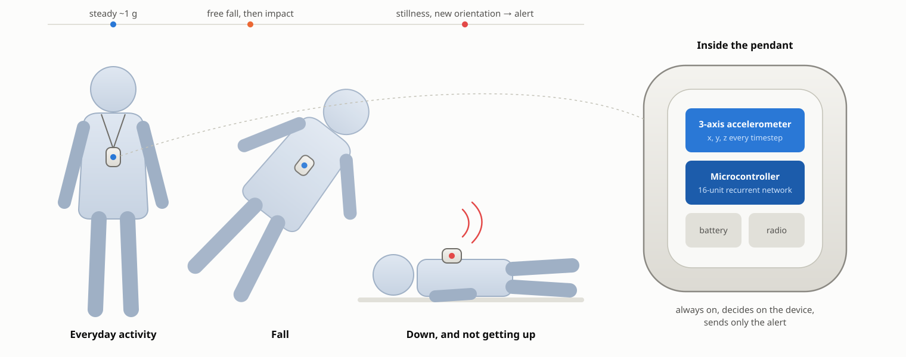
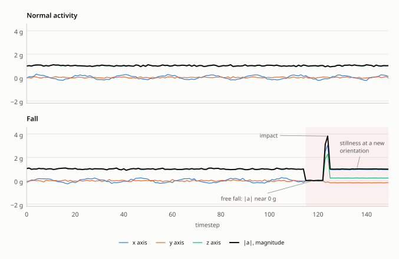
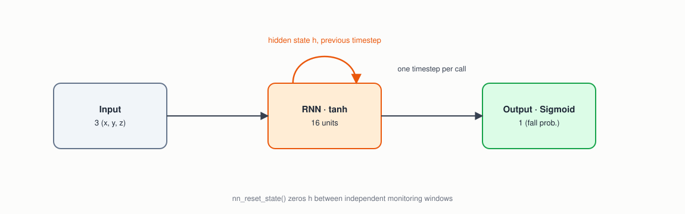
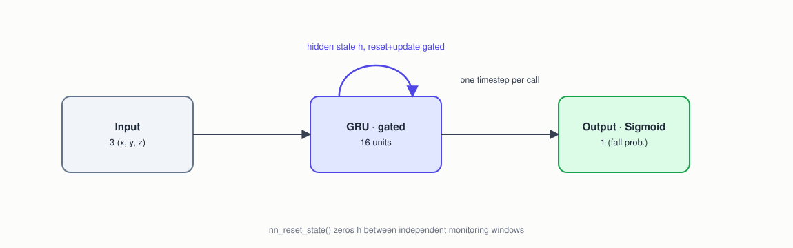
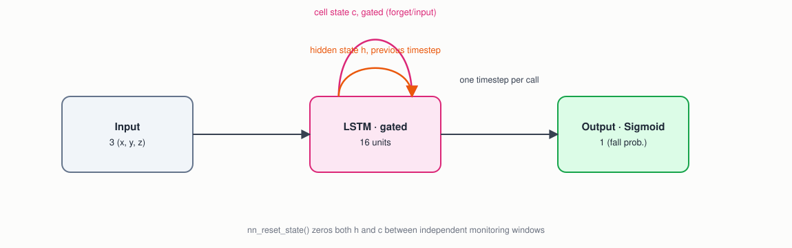
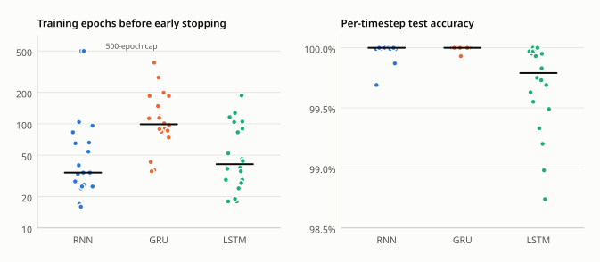

<p align="center">
  
</p>

> **Abstract.** A fall-detection pendant watches its wearer's movement continuously and has to tell a real fall from everything else a body does. A fall is a pattern over time — a brief free fall, a sharp impact, then a long stillness at an unusual orientation — so this example classifies a live 3-axis accelerometer stream one sample at a time with a recurrent network, and labels every timestep rather than a whole window. It trains three recurrent layer types on identical synthetic data: a plain RNN, a GRU and an LSTM, with 337 to 1,297 parameters. Over twenty training runs each, all three detected every test fall with no false alarms, every time. The plain RNN trains fastest, the GRU is the most accurate timestep by timestep, and the LSTM sits between them. The data is simulated, so these numbers measure the method, not a product.

| | |
|---|---|
| **Task** | Per-timestep classification of a 150-sample, 3-axis accelerometer stream: normal activity, or a fall from its onset on |
| **Data** | Synthetic, generated on the fly by `fall_data.[ch]`: daily-activity motion, with one fall spliced in at a random point in half the sequences |
| **Model** | One recurrent layer of 16 units (RNN, GRU or LSTM) → sigmoid; 337 / 977 / 1,297 parameters |
| **Hardware** | Any low-power microcontroller with a 3-axis accelerometer; the largest model is under 6 KB of float weights |
| **Result** | All three: 100% of falls detected and 0 false alarms in 20 of 20 runs each |

## 1. The problem

Fall-detection pendants and smartwatch fall alerts protect older and at-risk people who live alone. The device is always on, always watching a live accelerometer stream, and has to decide — continuously, on a battery-powered microcontroller — whether what just happened was a genuine fall worth raising an alarm for.

"Genuine" is the hard part. A fall isn't one instant; it's a *pattern over time*: a brief free-fall dip, then a sharp impact, then the person doesn't get up normally. Confirming a real fall, and not the device being set down hard on a table, means remembering the free-fall dip once the impact arrives, and then continuing to watch for unusual stillness for a long stretch afterward. That is a job for a network with memory: a recurrent layer, which carries a hidden state from one sample to the next.

## 2. The device

<p align="center">
  
</p>
<p align="center"><sub><b>Figure 1.</b> A fall-detection pendant. The accelerometer feeds the network one sample at a time; only an alert ever leaves the device. Schematic, not to scale.</sub></p>

The network is small enough for any microcontroller that can read an accelerometer: the largest of the three models, the LSTM, has 1,297 parameters (under 6 KB as 32-bit floats), and each sample costs one `nn_predict()` call.

## 3. The data

There's no dataset to download: `fall_data.[ch]` synthesizes every training, validation and test sequence on the fly, so nothing the model is tested on was ever seen in training. Each sequence is 150 timesteps of a 3-axis accelerometer, in g.

- **Normal activity:** gentle, noisy daily-activity motion, with the magnitude of acceleration near 1 g (gravity) throughout. Every timestep is labeled 0.
- **Fall:** the same, with one fall spliced in at a random onset: 5-8 timesteps of near-weightlessness (magnitude collapsing toward 0 g), a 1-2 timestep impact spike, then stillness for the rest of the sequence at a random new orientation — the body, and the device, have been turned over. Labels are 0 before the onset and 1 from the onset to the end, so an alert, once raised, stays raised.

<p align="center">
  
</p>
<p align="center"><sub><b>Figure 2.</b> One normal and one fall sequence from <code>fall_data.c</code>. The shaded span is labeled as a fall. After the impact, the magnitude returns to 1 g; what gives the fall away is the history: the free fall before it, and the axes holding still at a new orientation after.</sub></p>

A single sample can't tell these apart: the magnitude after a fall is the same 1 g as before it. The network has to carry the free fall and the impact in its hidden state for the rest of the sequence.

## 4. Method

### 4.1 Three recurrent layers

The library has three recurrent layer types, and the example trains each on the identical task, with one training program apiece and a shared `test.c`. All three read one accelerometer sample per call, carry their state to the next call, and output a fall probability every timestep; `nn_reset_state()` clears the state between independent sequences.

<p align="center">
  
</p>
<p align="center"><sub><b>Figure 3.</b> RNN (<code>train_rnn.c</code>): one hidden state, passed through tanh at every step.</sub></p>

<p align="center">
  
</p>
<p align="center"><sub><b>Figure 4.</b> GRU (<code>train_gru.c</code>): one hidden state, with reset and update gates deciding how much of it to keep at each step.</sub></p>

<p align="center">
  
</p>
<p align="center"><sub><b>Figure 5.</b> LSTM (<code>train_lstm.c</code>): a hidden state plus a separately gated cell state, built to hold a signal over long gaps.</sub></p>

| | RNN | GRU | LSTM |
|---|---|---|---|
| Recurrent layer | 16 units, tanh | 16 units; reset and update gates | 16 units; input, forget and output gates |
| Persistent state | `h` | `h` | `h` and cell state `c` |
| Parameters | 337 | 977 | 1,297 |
| Optimizer | Adam, learning rate 0.01 | SGD, learning rate 0.05 | SGD, learning rate 0.05 |

Each layer is followed by one sigmoid output. A GRU has about three times an RNN's parameters, and an LSTM about four, because each gate has its own weights for every hidden unit (see `LAYER_TYPE_GRU` and `LAYER_TYPE_LSTM` in `nn.h`).

### 4.2 Training and testing

All three train with `nn_train()` once per timestep, against that timestep's own label, on 100 freshly synthesized sequences per epoch. After each epoch they score a fixed validation set of 200 sequences, 100 normal and 100 with a fall, the same way `test.c` does, and keep the epoch with the **fewest detection mistakes** — missed falls plus false alarms — using mean error only to break ties. Training stops after 10 epochs without a better one.

Selecting on detection mistakes rather than on mean error matters here. A brief spike above 0.5 during normal activity costs a single timestep's worth of error but is a whole false alarm, so the epoch with the lowest error can be one that false-alarms. Replaying both rules over the same 60 training runs per architecture, selecting on error kept a false-alarming model in 3 (RNN), 10 (GRU) and 6 (LSTM) of the runs; selecting on mistakes kept none. `test.c` then evaluates a saved model on 100 new sequences, 50 normal and 50 with a fall, and reports:

- **per-timestep accuracy** over all 15,000 timesteps;
- **recall:** falls whose first detection (output at or above 0.5) came at or after the onset — a trigger before the onset counts as a miss;
- **false alarms:** normal sequences in which the output ever reached 0.5;
- **detection latency:** timesteps from the onset to the first detection, averaged over detected falls.

## 5. Results

Each architecture was trained and tested twenty times, with a different random seed each run.

<p align="center">
  
</p>
<p align="center"><sub><b>Figure 6.</b> Twenty training runs per architecture, each tested on 100 fresh sequences. Each dot is one run; the bar is the median. Every run of every architecture detected all 50 falls with no false alarms, so detection isn't plotted.</sub></p>

| | RNN | GRU | LSTM |
|---|---|---|---|
| Runs with every fall detected and no false alarms | 20 of 20 | 20 of 20 | 20 of 20 |
| Per-timestep accuracy, median (range) | 100.00% (99.69-100%) | 100.00% (99.93-100%) | 99.79% (98.74-100%) |
| Training epochs, median (range) | 34 (16-500) | 99 (35-386) | 41 (18-187) |
| Mean detection latency | 0 timesteps | 0 timesteps | 0 timesteps |

**All three detect falls reliably.** Every saved model, in all 60 runs, caught all 50 test falls and raised no false alarms. The free fall is unlike anything in normal activity, and every model flagged it at once: the mean time from onset to the first detection was 0.0 timesteps in every run, to the one decimal `test` prints.

**The plain RNN is enough for this task, and trains fastest** (median 34 epochs, with Adam). Its hidden state is pushed through tanh at every step, but the evidence it needs — the free fall, the impact, and a magnitude that settles at 1 g with the axes at new values — is strong enough to hold. In two runs its validation error kept creeping down at zero mistakes until the 500-epoch cap; it costs a few seconds.

**The GRU is the most accurate timestep by timestep** — 100.00% in 18 of 20 runs — but takes the longest to train, a median of 99 epochs with plain SGD. **The LSTM** trains in a median of 41 epochs and is slightly less exact timestep by timestep (median 99.79%, low 98.74%), without missing any detection. Per-timestep accuracy is the least important of these numbers: recall and false alarms are what a wearer would notice, and those are perfect for all three. Every run of all three trained in under 6 seconds on a desktop.

**Backpropagating through more timesteps doesn't help here.** All three train with the library's default of one timestep (`nn_set_bptt_depth()` in `nn.h`). Four runs each at a depth of 20 timesteps, and at the full 150 with one update per sequence (exact backpropagation through time), again caught every fall with no false alarms. Per-timestep accuracy moved by fractions of a point, mostly downward at depth 150, and at depth 20 most runs trained to the 500-epoch cap. In a trial RNN run through all 150 timesteps with an update every sample, training was unstable: validation error swung between zero mistakes and 200 from one epoch to the next. The evidence of a fall is strong and local, so there is little for a longer gradient to teach.

## 6. Running on the device

The firmware loop is one call per accelerometer sample: `nn_predict()` on the three axes, and an alert when the output crosses the threshold. The recurrent state lives inside the model, so the firmware keeps nothing between samples except the model itself; `nn_reset_state()` starts a new monitoring window. The weights, at 337-1,297 parameters, fit in a few kilobytes of flash, and the per-sample cost is a single small recurrent step. The repository's `quantize` and `export` tools convert a trained model to int8 and to the zero-copy inplace format for flash (see the top-level README).

## 7. Limitations

- **The data is simulated.** Real falls vary far more: slumping down a wall, falling onto furniture, falling slowly, or getting partway up. Real daily life includes events that look like falls — sitting down hard, dropping the device, a car going over a bump. A deployable detector needs training and testing on recorded falls and recorded daily activity.
- **The sample rate is unspecified.** `fall_data.c` works in timesteps, not seconds; the durations here (5-8 timesteps of free fall, 150-timestep windows) would need to be matched to a real accelerometer's rate.
- **One fall per window, and the label stays on.** A real monitor runs indefinitely and has to recover after the wearer gets up; this example's labels never return to 0 within a window.
- **No confirmation step.** Commercial devices typically wait for the wearer to cancel an alert before calling for help; that logic belongs in the application around the model.

## Appendix A. Build and run

```
cd examples/fall_detection
make
```

| Command | What it does |
|---|---|
| `./train_rnn model_rnn.txt` | trains the RNN on freshly synthesized sequences |
| `./train_gru model_gru.txt` | the same for the GRU |
| `./train_lstm model_lstm.txt` | the same for the LSTM |
| `./test model_rnn.txt` | tests any of the three on 50 normal and 50 fall sequences: per-timestep accuracy, recall, false alarms and latency |

Nothing is downloaded, and every run synthesizes new data, so results vary a little from run to run. Use a different model file per architecture to keep all three.

The figures in this document are generated by `tools/docs/fall_detection.py`.

## Appendix B. Program output

Each training program prints one example sequence of each kind before training (every third timestep, as acceleration magnitude and label). An excerpt of the fall sequence around its onset:

```
Sample FALL sequence (|accel| in g, every 3rd timestep):
  ...
  t= 78: |a|=1.01  label=0
  t= 81: |a|=1.03  label=0
  t= 84: |a|=0.02  label=1      <- free fall: magnitude collapses toward 0
  t= 87: |a|=0.02  label=1
  t= 90: |a|=1.00  label=1      <- the impact came between t=87 and t=90 (not sampled at this stride)
  t= 93: |a|=1.01  label=1      <- stillness: label stays 1 to the end of the window
  ...
```

`./train_rnn model_rnn.txt`, then `./test model_rnn.txt` (one of the twenty runs in figure 6):

```
train error, validation error, validation mistakes, learning rate
0.01945, 0.01107, 0, 0.01000
0.01014, 0.03653, 0, 0.01000
0.01338, 0.00482, 1, 0.01000
...
0.00000, 0.00000, 0, 0.01000
0.00000, 0.00000, 0, 0.01000
No validation improvement for 10 epochs (best: 0 mistakes, error 0.00000) -- stopping early.
Final (last epoch) train error: 0.000000, validation error: 0.000001
Best validation (the model saved to disk): 0 mistakes, error 0.000000
Training epochs: 34
Validation set, last epoch's weights (./test evaluates the saved model on fresh data):
Per-timestep accuracy: 30000/30000 = 100.00%
Falls detected: 100/100
False alarms (normal sequences that ever triggered): 0/100
Average detection latency (timesteps after true onset): 0.0
```
```
Test sequences: 50 normal, 50 fall (150 timesteps each, freshly synthesized)
Per-timestep accuracy: 15000/15000 = 100.00%
Falls detected (recall): 50/50 = 100.0%
False alarms (normal sequences that ever triggered): 0/50 = 0.0%
Average detection latency (timesteps after true onset): 0.0
```

The training program's summary scores its last epoch on the validation set; `test` evaluates the saved model on sequences it has never seen.

## References

1. S. Hochreiter and J. Schmidhuber, "Long short-term memory," *Neural Computation*, 1997.
2. K. Cho et al., "Learning phrase representations using RNN encoder-decoder for statistical machine translation," *EMNLP*, 2014 (the GRU).
