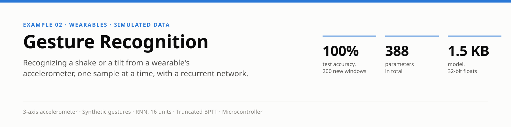
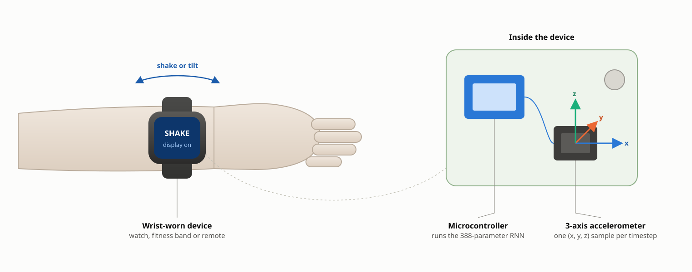
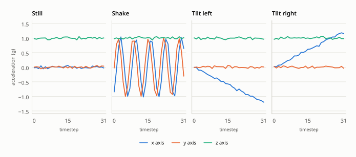
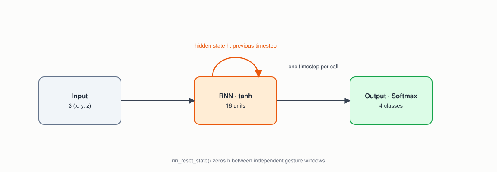
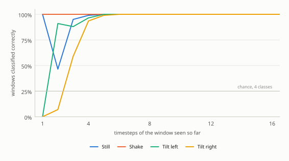

<p align="center">
  
</p>

> **Abstract.** A smartwatch that wakes when you flick your wrist, or a remote that changes channel when you tilt it, needs a classifier small enough to run continuously on the device's microcontroller. This example trains a 388-parameter recurrent network (RNN) to tell four gestures apart — still, shake, tilt left, tilt right — from a 3-axis accelerometer, fed one sample at a time, so the network carries what it has seen so far in a hidden state instead of storing the whole window. Training data is synthesized on the fly, so there is nothing to download. On 200 freshly generated test windows it is 100% accurate, and every window is already classified correctly after its first 8 of 32 samples. The gestures are simplified, synthetic waveforms; the example demonstrates the recurrent mechanics, not performance on real wrists.

| | |
|---|---|
| **Task** | 4-way classification of a 32-sample window from a 3-axis accelerometer |
| **Data** | Synthetic gesture waveforms with randomized frequency, phase and noise, generated by `gesture_data.c` |
| **Model** | RNN, 16 tanh units → softmax 4; 388 parameters; one sample per call, truncated BPTT of depth 1 |
| **Hardware** | Any microcontroller beside a MEMS accelerometer (wristband, watch or remote) |
| **Result** | 200 / 200 test windows correct; all correct from timestep 8 onward |

## 1. The problem

Gesture control is everywhere in small devices: a smartwatch recognizing a flick of the wrist to wake its display, a TV remote mapping a shake or a tilt to a command, a fitness band detecting a specific motion to start counting repetitions. All of them share the same constraint — a tiny, continuously running classifier reading a live accelerometer stream on a microcontroller, not a server.

A single accelerometer reading can't tell a shake from a tilt or from holding still: what distinguishes them is the *shape of the motion over time*. A recurrent layer [1] gives the network a hidden state that persists from one call to the next, so it builds up a picture of the gesture as samples arrive, using a fixed, small amount of memory no matter how long it listens.

## 2. The device

<p align="center">
  
</p>
<p align="center"><sub><b>Figure 1.</b> The device this example targets: an accelerometer and a microcontroller inside a wrist-worn device. Each new (x, y, z) sample goes straight into the network. Schematic, not to scale.</sub></p>

The whole model is 388 parameters — 1.5 KB as 32-bit floats — and each sample costs about 370 multiply-adds, so it fits beside the application on the smallest microcontrollers and can run at the accelerometer's own sample rate.

## 3. The data

There is no dataset to download: `gesture_data.c` synthesizes every window as it's needed, so the network never sees the same window twice. Each window is 32 samples of (x, y, z) acceleration in units of g, with a device at rest reading about 1 g on z:

| Gesture | Waveform |
|---|---|
| **Still** | sensor noise only, around (0, 0, 1 g) |
| **Shake** | a fast oscillation on x and y, a radian apart in phase: about 3 to 5 cycles per window, random phase |
| **Tilt left** | x ramps steadily from 0 to −1.2 g as the device rotates |
| **Tilt right** | x ramps from 0 to +1.2 g |

Every sample gets small random noise (up to ±0.08 g) on every axis, and the shake's frequency and phase are re-drawn for every window, so no two windows of a class are identical.

<p align="center">
  
</p>
<p align="center"><sub><b>Figure 2.</b> One generated window of each gesture, straight from <code>gesture_data.c</code>.</sub></p>

## 4. Method

### 4.1 Network

<p align="center">
  
</p>
<p align="center"><sub><b>Figure 3.</b> The recurrent network. The loop carries the hidden state from one sample to the next; <code>nn_reset_state()</code> clears it between gestures.</sub></p>

| Layer | Type | Output shape | Notes |
|---|---|---|---|
| 0 | Input | 3 | one accelerometer sample (x, y, z) per call |
| 1 | RNN | 16 | tanh; hidden state persists across calls (see `LAYER_TYPE_RNN` in `nn.h`) |
| 2 | Output | 4 | Softmax over still, shake, tilt left, tilt right |

388 trainable parameters: 64 for the input weights and biases, 256 for the recurrent weights, 68 for the output layer.

### 4.2 Training

`train.c` calls `nn_train()` once per *timestep* of a 32-sample window, not once per window, with the window's label as the target at every timestep. Early samples may not be distinctive yet, but repeating the label gives the network a training signal at every step. `nn_reset_state()` runs before each window so one gesture's hidden state never leaks into the next. The recurrent connection is trained with truncated backpropagation through time [2] of depth 1, which keeps memory flat however long a sequence runs — important on a microcontroller, where storing a whole sequence to backpropagate through isn't an option.

Each epoch trains on 200 freshly generated windows at a learning rate of 0.05, and training stops once the error on a fixed set of 32 validation windows hasn't improved for 5 epochs. That error is the cross-entropy averaged over *every* timestep of each window, including the first few, where still and the two tilts look alike; a confident wrong guess there is expensive, which is why it swings from epoch to epoch even while the final classification is already perfect.

## 5. Results

`test` classifies 200 freshly generated windows, 50 per gesture, from the network's output after the last sample: all 200 are correct. (The task is simple by design; see [Limitations](#7-limitations).)

The more interesting question for a recurrent network is how soon it knows. Reading the output after every sample instead of only the last:

<p align="center">
  
</p>
<p align="center"><sub><b>Figure 4.</b> How the running classification firms up: the share of windows already classified correctly after each timestep, 200 generated windows per gesture, for one trained model.</sub></p>

Shake is recognized almost from the first sample — it starts at a random point of its oscillation, far from rest. Still and the two tilts all begin at rest and only separate as the tilt's ramp builds, so the network needs a few samples to tell them apart. In each of four separately trained models measured, every window was classified correctly by timestep 8 of 32 and stayed correct to the end; exactly how the first few timesteps go differs from model to model. On a device sampling at 100 Hz, timestep 8 is 80 ms into the gesture.

## 6. Running on the device

The firmware loop is the test loop: call `nn_reset_state()` when a gesture begins, `nn_predict()` with each new (x, y, z) sample as the accelerometer delivers it, and act on the output when the gesture window ends — or as soon as the winning class is confident enough. Nothing is buffered: the hidden state *is* the memory of the gesture so far, 16 floats.

Exported in the zero-copy inplace format that `nn_load_model_inplace()` runs straight out of flash (`../../export ... --inplace`; see the top-level README), the model is 1,604 bytes. Quantized to 8 bits first with `../../quantize`, it is 528 bytes, and still classified all 200 test windows correctly.

## 7. Limitations

- **Synthetic gestures.** Real gestures vary with the person, the device's orientation on the wrist, gravity's direction and everyday motion. A product model needs recorded data, and probably all three axes of a gyroscope as well.
- **Four clean classes, aligned windows.** Every test window contains exactly one gesture, starting at sample 0. A device has to find gestures in a continuous stream and reject everyday motion that isn't any of them, which needs a "none of these" class and a way to decide when a gesture starts.
- **A perfect score on an easy task.** 100% here shows the recurrent mechanics working, not that gesture recognition is solved.

## Appendix A. Build and run

```
cd examples/gesture_recognition
make
```

| Command | What it does |
|---|---|
| `./train gesture_model.txt` | prints one sample window per gesture, then trains on freshly generated windows (under a second) |
| `./test gesture_model.txt` | classifies 200 new windows and prints a confusion matrix |

The figures in this document are generated by `tools/docs/gesture_recognition.py`.

## Appendix B. Program output

`train.c` first prints one window per gesture (every timestep; excerpted here), the "look at your data" step:
```
Sample gesture windows (accelerometer x, y, z per timestep):

STILL:
  t= 0:  0.015 -0.015  0.984
  t= 1: -0.038  0.031  1.020
  t= 2:  0.006 -0.004  1.018
  ...
  t=31:  0.027  0.004  0.998

SHAKE:
  t= 0:  0.897  0.077  1.000
  t= 1:  0.272 -0.648  1.017
  t= 2: -0.539 -1.025  0.983
  ...
  t=31:  0.393 -0.561  0.990
```

Training log:
```
Creating new model.
train error, validation error, learning rate
0.29578, 1.81759, 0.05000
0.16190, 1.79111, 0.05000
0.13894, 1.18763, 0.05000
0.12505, 0.67710, 0.05000
0.10936, 3.03353, 0.05000
0.10431, 2.21054, 0.05000
0.09577, 0.92978, 0.05000
0.09094, 2.65472, 0.05000
0.09116, 0.58077, 0.05000
0.09810, 1.06409, 0.05000
0.08802, 0.21912, 0.05000
0.11396, 1.34848, 0.05000
0.10523, 0.12428, 0.05000
0.08006, 0.28865, 0.05000
0.08051, 0.11624, 0.05000
0.07846, 0.10857, 0.05000
0.08308, 0.11996, 0.05000
0.07769, 0.15510, 0.05000
0.07463, 0.19966, 0.05000
0.08135, 0.17725, 0.05000
0.07942, 0.63015, 0.05000
No validation improvement for 5 epochs (best: 0.10857) -- stopping early.
Final (last epoch) train error: 0.079424, validation error: 0.630146
Best validation error (the model saved to disk): 0.108568
Validation accuracy (final-timestep classification): 32/32
Training epochs: 21
Gesture classes: 0=STILL, 1=SHAKE, 2=TILT_LEFT, 3=TILT_RIGHT
```

`test gesture_model.txt`:
```
Confusion matrix (rows = actual, columns = predicted), 50 windows per class:
            STILL       SHAKE       TILT_LEFT   TILT_RIGHT  
STILL       50          0           0           0             (50/50 = 100.0%)
SHAKE       0           50          0           0             (50/50 = 100.0%)
TILT_LEFT   0           0           50          0             (50/50 = 100.0%)
TILT_RIGHT  0           0           0           50            (50/50 = 100.0%)

Overall accuracy: 200/200 = 100.00%
```

## References

1. J. L. Elman, "Finding structure in time," *Cognitive Science*, 1990.
2. P. J. Werbos, "Backpropagation through time: what it does and how to do it," *Proceedings of the IEEE*, 1990.
