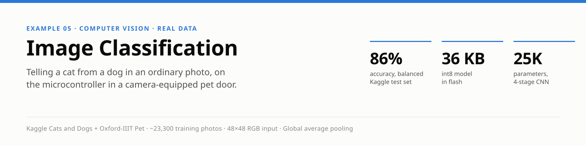
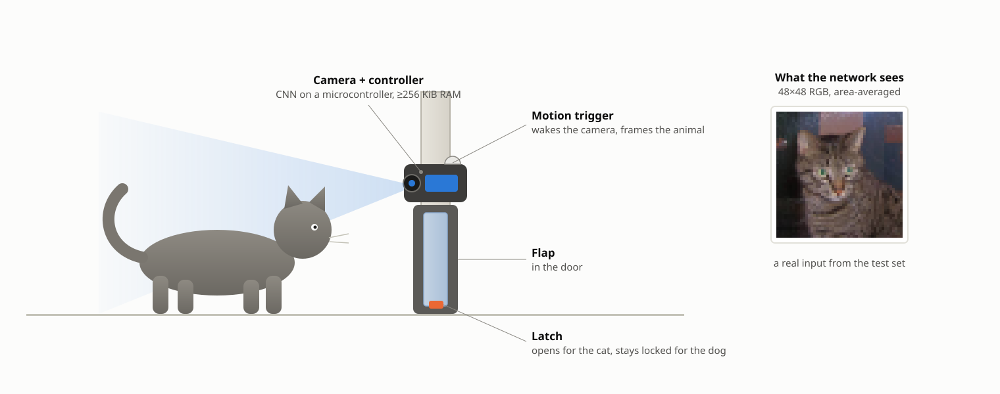
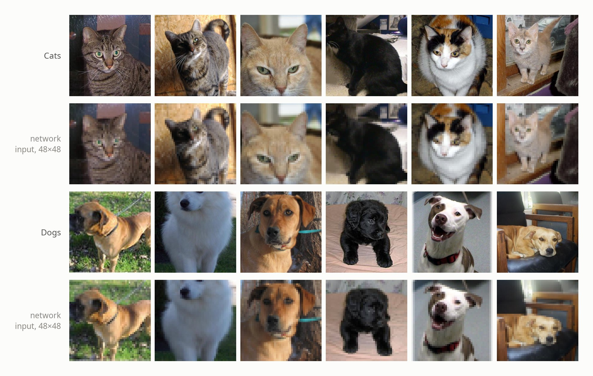
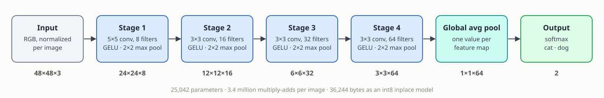
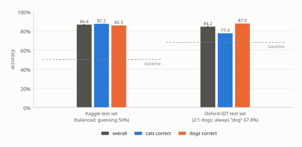
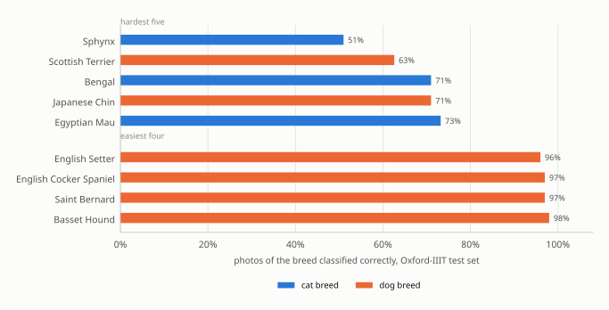

<p align="center">
  
</p>

> **Abstract.** A camera-equipped pet door has to decide, on the spot and on its own microcontroller, whether the animal in front of it is the cat it should let in or the dog it should keep out. This example trains a 25,042-parameter convolutional network for that decision on about 23,300 ordinary pet photos from two public datasets, Kaggle Cats and Dogs and Oxford-IIIT Pet. Each photo is cropped and area-averaged to 48×48 RGB pixels by the same preprocessing code that would run on the device. Over five training runs it classifies 85.2–86.7% of a balanced held-out test set correctly (guessing scores 50%) and 83.9–84.9% of Oxford's dog-heavy test set (always answering "dog" scores 67.8%). Quantized to int8 it occupies 36 KB of flash and needs about 92 KiB of RAM. Roughly one photo in seven is still misclassified; the numbers are reported as measured.

| | |
|---|---|
| **Task** | Binary image classification: cat or dog, one photo at a time |
| **Data** | Kaggle Cats and Dogs (25,000 photos) and Oxford-IIIT Pet (~7,400 photos of 37 breeds), downloaded by the Makefile |
| **Model** | 4-stage CNN (5×5 and 3×3 convolutions, GELU, max pooling) → global average pooling → softmax 2; 25,042 parameters |
| **Hardware** | Any microcontroller with ≥256 KiB of RAM and a camera; 36,244 bytes of flash for the int8 model |
| **Result** | 86.2% average accuracy on the balanced Kaggle test set, 84.4% on the Oxford test set (five runs) |

## 1. The problem

Think of a camera-equipped pet door that lets the cat through but stays locked for the dog, or a feeder that only opens for the cat. A camera at the door or bowl wakes when something approaches and has to decide on the spot, on the device itself, with no cloud round-trip between the animal arriving and the latch deciding — the same reason [`wake_word_detection`](../wake_word_detection/README.md) runs its listener on the device.

Like [`character_recognition`](../character_recognition/README.md), this example classifies one whole image at a time with stacked convolution and pooling layers. Unlike MNIST's centered digits on blank backgrounds, these are ordinary pet photos — on couches, lawns, and in people's arms — and the task is harder than it sounds.

## 2. The device

<p align="center">
  
</p>
<p align="center"><sub><b>Figure 1.</b> The application this example targets. A motion trigger wakes the camera; the controller classifies the animal and drives the latch. Inset: the 48×48 input the network actually receives, from a held-out test photo. Schematic, not to scale.</sub></p>

The pieces map onto firmware the same way [`wake_word_detection`](../wake_word_detection/README.md)'s do:

1. **Region of interest.** Something has to say *where* in the frame the animal is. On a real device that's a motion detector's changed-pixel bounding box; a camera mounted right at a pet door sees the animal fill most of the frame anyway, so `predict.c` defaults to the whole frame when no box is given.
2. **Preprocessing** (`image_prep.[ch]`): crop a square around that region, area-average it down to 48×48 RGB, and normalize it to zero mean and unit variance. No heap and no file I/O, so this ships into firmware next to `nn.c`/`nn.h`; the firmware has to run exactly what built the training data. It is the image counterpart of `audio_features.[ch]`.
3. **The classifier** (`train.c`): the CNN of [section 4.2](#42-network), with a 2-way softmax output.

`predict.c` illustrates that split: everything in it except decoding the image file is what firmware would do, since a camera hands over raw pixels from its sensor driver.

## 3. The data

Two public datasets are used together: Microsoft's [Kaggle Cats and Dogs](https://www.microsoft.com/en-us/download/details.aspx?id=54765) set — 25,000 shelter photos from Petfinder.com, originally collected for the Asirra CAPTCHA [1]; CDLA-Permissive 2.0 — and the [Oxford-IIIT Pet dataset](https://www.robots.ox.ac.uk/~vgg/data/pets/) [2], ~7,400 photos of 37 breeds (CC BY-SA 4.0, with image copyright remaining with the original owners).

<p align="center">
  
</p>
<p align="center"><sub><b>Figure 2.</b> Held-out Kaggle test photos (center square shown) and the 48×48 inputs <code>image_prep</code> makes of them. Photos from Kaggle Cats and Dogs, CDLA-Permissive 2.0.</sub></p>

`prepare_data.c` decodes the images with [`stb_image.h`](https://github.com/nothings/stb) (vendored at the repository root and shared with [`object_detection`](../object_detection/README.md); public domain / MIT; v2.30, commit `2c980bb`) and writes these CSVs:

| File | Source | Cat images | Dog images |
|---|---|---|---|
| `train.csv` | Kaggle photos numbered 2–9 mod 10, plus Oxford `trainval.txt` minus every 10th image | 11,068 | 12,241 |
| `validation.csv` | Kaggle photos numbered 0 mod 10, plus every 10th Oxford `trainval.txt` image | 1,368 | 1,500 |
| `test.csv` | Kaggle photos numbered 1 mod 10 | 1,250 | 1,250 |
| `test_oxford.csv` | Oxford `test.txt` (the dataset's published test split) | 1,183 | 2,486 |
| `test_oxford_labels.txt` | one breed name per `test_oxford.csv` row, for `test.c`'s per-breed breakdown | | |

The Kaggle photos come numbered 0–12,499 per class with no meaningful order and no published split, so splitting by number is an arbitrary but fixed, reproducible split. About 230 of them are actually BMP, GIF, or PNG files under a `.jpg` name, which `stb_image` decodes fine. Three are skipped (two empty files and one Photoshop file).

The two test sets answer different questions:

- `test.csv` is balanced, so guessing scores **50%**. It measures how well the model handles more photos like most of what it trained on.
- `test_oxford.csv` has twice as many dogs as cats (25 dog breeds vs. 12 cat), so always answering "dog" scores **67.8%**. Its breed labels show *which* cats and dogs the model confuses.

**Region of interest in training.** For Oxford photos the crop is a bounding box derived from the dataset's per-pixel animal outline (its "trimap"); Kaggle photos have no such annotation, so they use the whole frame. A real motion detector's boxes will be sloppier, which is why training also uses randomly shifted and rescaled crops, not just exact boxes.

**Augmentation.** Only `train.csv` is augmented. Every image becomes at least two rows, the crop and its mirror image, and each class is brought to ~20,000 rows; with the combined datasets nearly balanced, every image gets exactly those two rows. A class with fewer images would get extra randomly mirrored crops, shifted and rescaled by up to ±15% of the box size. The evaluation CSVs are not augmented. The augmentation uses a fixed random seed, so rerunning `prepare_data` reproduces the same `train.csv`.

## 4. Method

### 4.1 Preprocessing

`image_prep.[ch]` turns a camera frame and a region of interest into the network's input: a square crop around the region, area-averaged to 48×48 RGB, then normalized per image to zero mean and unit variance. Area averaging (rather than point sampling) keeps every source pixel's contribution, so the 48×48 image is a faithful thumbnail rather than an aliased one. The normalization removes overall brightness and contrast, which vary far more between cameras and lighting than between cats and dogs.

### 4.2 Network

<p align="center">
  
</p>
<p align="center"><sub><b>Figure 3.</b> The network in <code>train.c</code>. Each stage is a convolution with a GELU activation followed by 2×2 max pooling; the shape under each box is its output.</sub></p>

| Layer | Type | Output shape | Notes |
|---|---|---|---|
| 0 | Input | 48×48×3 | RGB, normalized per image |
| 1 | CNN | 48×48×8 | 5×5 kernel, 8 filters, "same" padding, GELU |
| 2 | Pool | 24×24×8 | 2×2 max pool, stride 2 |
| 3 | CNN | 24×24×16 | 3×3 kernel, 16 filters, "same" padding, GELU |
| 4 | Pool | 12×12×16 | 2×2 max pool, stride 2 |
| 5 | CNN | 12×12×32 | 3×3 kernel, 32 filters, "same" padding, GELU |
| 6 | Pool | 6×6×32 | 2×2 max pool, stride 2 |
| 7 | CNN | 6×6×64 | 3×3 kernel, 64 filters, "same" padding, GELU |
| 8 | Pool | 3×3×64 | 2×2 max pool, stride 2 |
| 9 | Pool | 1×1×64 | 3×3 average pool ("global average pooling"): one value per feature map |
| 10 | Output | 2 | Softmax (cross-entropy loss): cat, dog |

25,042 trainable parameters, all but 130 of them in the four convolutional layers. There's no fully-connected hidden layer: global average pooling [3] reduces each of the 64 final feature maps to its average, so the output layer sees "how strongly each learned feature shows up anywhere in the crop" rather than a 576-wide map of where it showed up. That keeps the parameter count low and makes the classifier largely indifferent to where in the crop the animal sits.

## 5. Results

Training isn't seeded, so every run lands somewhere different. Five runs of the current code scored **85.2–86.7%** (average 86.2%) on the balanced Kaggle test and **83.9–84.9%** (average 84.4%) on the Oxford test. The figures show one representative run; [appendix B](#appendix-b-program-output) has its full output.

### 5.1 Accuracy

<p align="center">
  
</p>
<p align="center"><sub><b>Figure 4.</b> Accuracy of one trained model on the two held-out test sets, overall and per class. The tick on each overall bar spans the five-run range; dashed lines mark each test set's trivial baseline.</sub></p>

Roughly one photo in seven is misclassified. On the balanced Kaggle test the errors are nearly even between the classes (87.2% of cats and 85.5% of dogs correct in this run). On Oxford the model leans toward "dog": averaged over the five runs it catches 74.8% of cats and 89.0% of dogs. Figure 5 shows which breeds account for most of it.

### 5.2 By breed

<p align="center">
  
</p>
<p align="center"><sub><b>Figure 5.</b> Per-breed accuracy on the Oxford test set, the five hardest and the four easiest breeds, from the same run (about 100 test photos per breed).</sub></p>

The hardest breeds are the plausible ones:

- **Unusual-looking cats:** hairless Sphynx is the hardest (51%), then Bengal with its leopard-like spots and the slender Egyptian Mau (71–73%).
- **Small or fluffy dogs:** Scottish Terrier (63%), Japanese Chin (71%).
- **Easiest:** large hounds, setters and spaniels such as Basset Hound (98%), Saint Bernard and English Cocker Spaniel (97%).

## 6. Running on the device

| Resource | Cost |
|---|---|
| **Flash** | **36,244 bytes**, quantized to int8 and exported with `export --inplace`. Quantization cost no measurable accuracy: 86.28% / 84.11% on the two test sets vs. the float model's 86.36% / 84.22%. |
| **RAM** | About **92 KiB**: a model loaded with `nn_load_model_inplace()` keeps its weights in flash, and its activations in two buffers that every layer shares, each as wide as the widest layer it holds; most of it is the first convolution's 48×48×8 output. Plus the caller's 27 KiB input buffer. That fits a 256 KiB-RAM microcontroller, but not a 128 KiB one. |
| **Compute** | About **3.4 million** multiply-adds per image. |

To build the flash-resident int8 model:

```
../../quantize model.txt model_q.txt
../../export model_q.txt model.inplace --inplace
./test model.inplace
```

**More accuracy, if RAM allows.** `IMG_SIZE` in `image_prep.h` (any multiple of 16) and the channel counts in `train.c` trade RAM for accuracy. Measured over two runs each, a 64×64 input reached 87.2% / 85.7% on the two test sets with ~166 KiB of activations, and doubling every stage's channels at 48×48 reached 88.1% / 86.1% (and 83% of Oxford's cats) with ~182 KiB. Either still fits a 256 KiB part. Changing either means rerunning `make`, which rebuilds the CSVs, and training a fresh model.

## 7. Limitations

- **Not a finished product.** Roughly one photo in seven is misclassified, and on Oxford's breeds a quarter of cats are called dogs. A pet door built on this would lock a cat out regularly.
- **Box quality.** The Oxford training crops come from careful per-pixel outlines, and the Kaggle photos use the whole frame. A real motion detector's boxes will be somewhere in between, so measure with your own detector in the loop before trusting these numbers.
- **Decision threshold.** `test.c` and `predict.c` pick whichever class scores higher. A pet door that errs toward keeping the dog out could require a higher cat score before opening, trading missed cats for fewer false openings. That trade-off isn't measured here.
- **Two kinds of animal.** Anything else at the door — a fox, a neighbor's cat, a raccoon — is still forced into "cat" or "dog". A deployed door would need a third class, or at least a confidence threshold, for animals it shouldn't recognize.

## Appendix A. Build and run

```
cd examples/image_classification
make
```

The first `make` downloads both datasets and extracts them into `dataset/`: Kaggle Cats and Dogs (~790 MB zip from Microsoft's download center) and Oxford-IIIT Pet (~790 MB of images and ~19 MB of annotations from Oxford's own host, which can be slow — about half an hour at 250 KB/s). It then builds `prepare_data` and runs it to produce the CSVs (a couple of minutes; `train.csv` is ~2.4 GB at 48×48), and builds `train`/`test`/`predict`. `make clean` keeps the downloads; `make distclean` removes them too.

| Command | What it does |
|---|---|
| `./train model.txt` | trains the model: ~46,000 rows at 48×48, about 20 epochs; the five runs measured here took 1.5–2 hours each while sharing the machine with 10–17 other training runs, so a run on its own is faster. Re-running resumes from an existing model file |
| `./test model.txt` | confusion matrices, per-class and overall accuracy on both held-out test sets, and accuracy per Oxford breed |
| `./predict model.txt <image> [x y w h]` | classifies one image (JPEG, PNG, BMP, or GIF); the optional box is the animal's region in pixel coordinates, otherwise the frame's center square is used |

`prepare_data.c`'s `OXFORD_TRAIN` setting controls whether Oxford's training images go into `train.csv`/`validation.csv` (the default) or only its test split is used. Oxford is downloaded either way, since `test_oxford.csv` needs it.

The figures in this document are generated by `tools/docs/image_classification.py`.

## Appendix B. Program output

Training log (`train`):
```
Creating new model.
train error, validation error, learning rate
0.62633, 0.56241, 0.00100
0.55854, 0.51587, 0.00100
0.51216, 0.48549, 0.00100
0.47403, 0.44378, 0.00100
0.44341, 0.41739, 0.00100
0.41864, 0.41712, 0.00100
0.39564, 0.37927, 0.00100
0.37651, 0.36542, 0.00100
0.35843, 0.36972, 0.00100
0.34314, 0.39865, 0.00100
0.32828, 0.34417, 0.00100
0.31244, 0.32730, 0.00100
0.30148, 0.34626, 0.00100
0.28957, 0.33260, 0.00100
0.27856, 0.32466, 0.00100
0.26898, 0.31379, 0.00100
0.26042, 0.32751, 0.00100
0.24868, 0.31187, 0.00100
0.24105, 0.32590, 0.00100
0.23193, 0.32259, 0.00100
0.22454, 0.32146, 0.00100
0.21519, 0.33553, 0.00100
0.20847, 0.40704, 0.00100
No validation improvement for 5 epochs (best: 0.31187) -- stopping early.
Final (last epoch) train error: 0.208470, validation error: 0.407035
Best validation error (the model saved to disk): 0.311868
Training epochs: 23
```

`test model.txt` (per-breed table abridged to the five worst and five best):
```
test.csv (held-out Kaggle Cats and Dogs photos):
          cat       dog
cat       1090      160         (1090/1250 = 87.2%)
dog       181       1069        (1069/1250 = 85.5%)
Overall accuracy: 2159/2500 = 86.36%

test_oxford.csv (Oxford-IIIT Pet test split):
          cat       dog
cat       914       269         (914/1183 = 77.3%)
dog       310       2176        (2176/2486 = 87.5%)
Overall accuracy: 3090/3669 = 84.22%

Accuracy by breed (worst first):
  Sphynx                       cat   51/100 =  51.0%
  scottish_terrier             dog   62/ 99 =  62.6%
  Bengal                       cat   71/100 =  71.0%
  japanese_chin                dog   71/100 =  71.0%
  Egyptian_Mau                 cat   71/ 97 =  73.2%
  ...
  english_setter               dog   96/100 =  96.0%
  english_cocker_spaniel       dog   97/100 =  97.0%
  saint_bernard                dog   97/100 =  97.0%
  basset_hound                 dog   98/100 =  98.0%
```

`predict` on a cat and a dog from the Oxford test split, whole frame:
```
$ ./predict model.txt dataset/images/British_Shorthair_97.jpg
cat: 0.99991
dog: 0.00009
Prediction: cat
$ ./predict model.txt dataset/images/japanese_chin_40.jpg
cat: 0.10728
dog: 0.89272
Prediction: dog
```

## References

1. J. Elson, J. R. Douceur, J. Howell and J. Saul, "Asirra: a CAPTCHA that exploits interest-aligned manual image categorization," *ACM Conference on Computer and Communications Security*, 2007.
2. O. M. Parkhi, A. Vedaldi, A. Zisserman and C. V. Jawahar, "[Cats and dogs](https://www.robots.ox.ac.uk/~vgg/publications/2012/parkhi12a/parkhi12a.pdf)," *IEEE Conference on Computer Vision and Pattern Recognition*, 2012.
3. M. Lin, Q. Chen and S. Yan, "Network in network," *International Conference on Learning Representations*, 2014.
