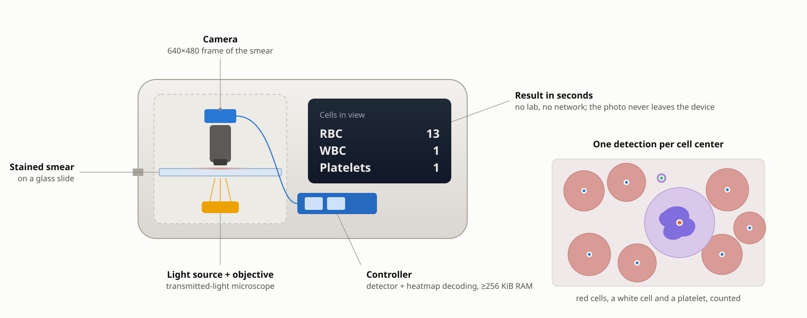
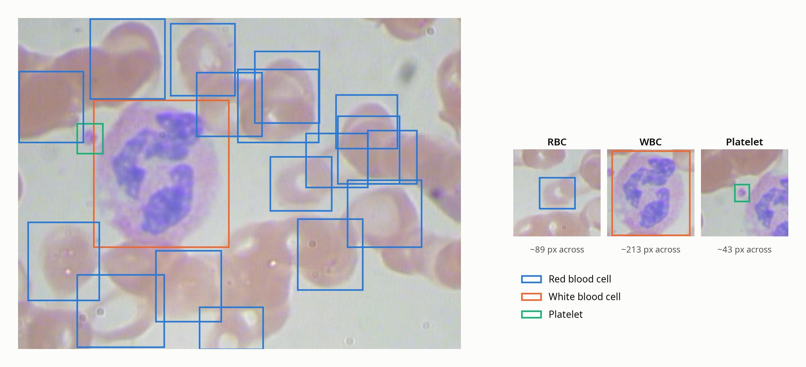
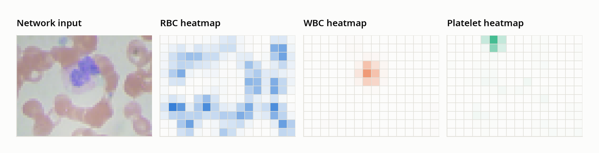
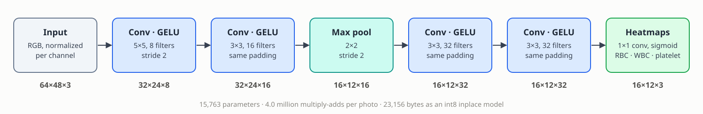
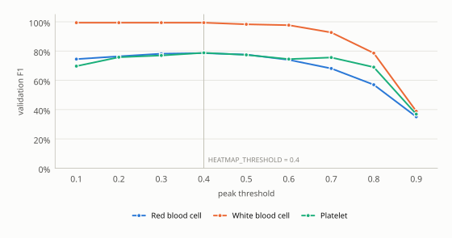
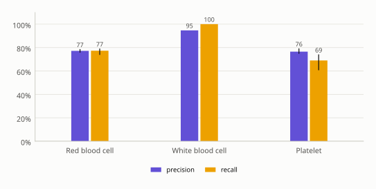
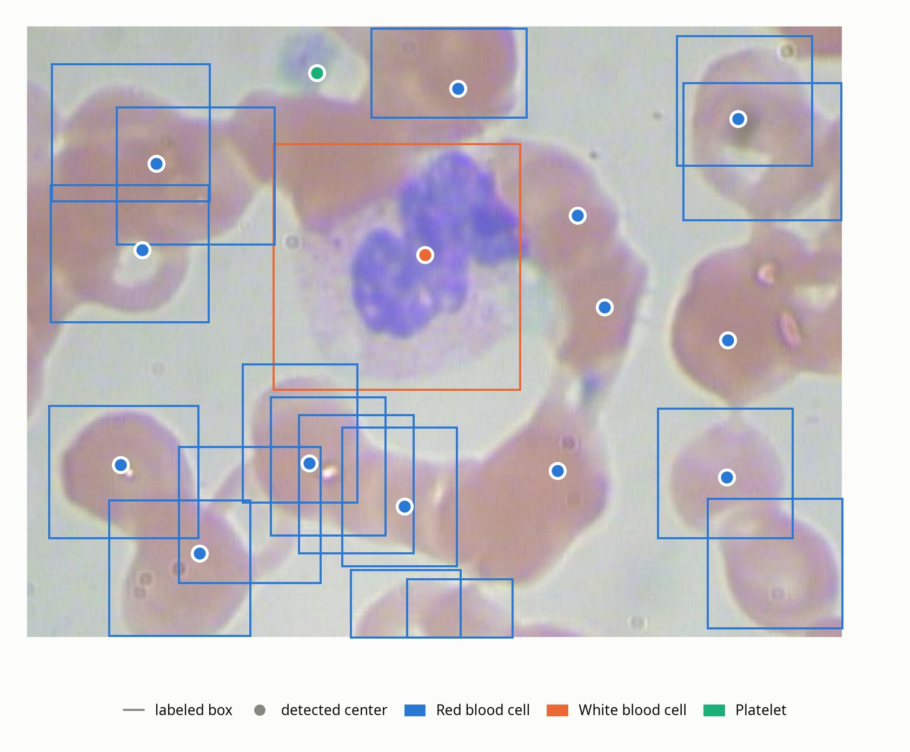

<p align="center">
  
</p>

> **Abstract.** A complete blood count is, at its core, counting: red cells, white cells and platelets in a known volume of blood. This example trains a 15,763-parameter fully convolutional network to find and count all three in a microscope photo of a stained blood smear, using the public BCCD dataset of 364 labeled photos. Instead of predicting boxes, the network outputs one coarse heatmap per class whose peaks mark cell centers, so detection needs no changes to the library. On BCCD's held-out test photos, averaged over five trained models, it finds every one of the 71 labeled white cells, reaches 77% F1 on red cells with an unbiased total count, and 72% F1 on platelets. Quantized to int8 it fits in 23 KB of flash and about 73 KiB of RAM. The dataset's labels miss many cells, which limits what any score against them can show; the numbers are reported as measured, with that limit quantified.

| | |
|---|---|
| **Task** | Object detection and counting: red blood cells, white blood cells and platelets in one photo |
| **Data** | BCCD (Blood Cell Count and Detection): 364 photos of stained smears with a labeled box around each cell; MIT license; downloaded by the Makefile |
| **Model** | Fully convolutional network, 64×48 RGB input → three 16×12 center heatmaps (1×1 convolution + sigmoid); 15,763 parameters |
| **Hardware** | Any microcontroller with ≥256 KiB of RAM and a camera on a microscope; 23,156 bytes of flash for the int8 model |
| **Result** | Test-set F1, mean of five models: white cells 97.3% (all 71 found), red cells 77.2%, platelets 72.5% |

## 1. The problem

Every other example in this series gives one answer per input: a digit, a gesture, cat or dog. This one says *what* is in the frame, *where*, and *how many* — which is what object detection means. A blood count is a counting problem, so it makes a natural first detector.

Think of a handheld blood analyzer, or a microscope camera clipped onto a phone, at a rural clinic or a field hospital. A complete blood count is, at its core, counting: how many red cells, white cells and platelets are in a known volume of blood. Doing it on the device means a result in seconds with no lab and no network connection, and a patient's blood photo that never leaves the device.

## 2. The device

<p align="center">
  
</p>
<p align="center"><sub><b>Figure 1.</b> The application this example targets: a camera on a small transmitted-light microscope, and a controller that turns each frame into cell counts. The counts shown are <code>predict</code>'s for the test photo in figure 7. Schematic, not to scale.</sub></p>

The pieces map onto firmware the same way [`image_classification`](../image_classification/README.md)'s do:

1. **Preprocessing** (`image_prep.[ch]`): area-average the whole 640×480 camera frame down to 64×48 RGB and normalize each color channel to zero mean and unit variance. Unlike `image_classification`, there's no crop: a detector has to look at the whole frame. No heap and no file I/O, so this ships into firmware next to `nn.c`/`nn.h`.
2. **The detector** (`train.c`): the fully convolutional network of [section 4.2](#42-network), whose output is one 16×12 heatmap per class.
3. **Decoding** (`heatmap.[ch]`): turn the three heatmaps into a list of detections (class, position, score) by finding their peaks. This is the step between `nn_predict()` and "13 red cells, 1 white cell, 1 platelet", so it ships into firmware too.

`predict.c` illustrates that split: everything in it except decoding the image file is what firmware would do.

## 3. The data

BCCD [1] is 364 photos of stained blood smears, 640×480 pixels, with a Pascal VOC box around each labeled cell. `prepare_data.c` decodes the photos with [`stb_image.h`](https://github.com/nothings/stb) (vendored at the repository root and shared with `image_classification`), reads each photo's XML annotation, and keeps BCCD's published train/val/test split. The Makefile downloads a pinned commit of the dataset (~8 MB).

<p align="center">
  
</p>
<p align="center"><sub><b>Figure 2.</b> Test photo <code>BloodImage_00011</code> with its labeled boxes, and one cell of each class cropped at the same scale. Note the red cells at the right with no box: the labels are incomplete (see below). Photo from the BCCD dataset, MIT license.</sub></p>

| File | Source | Photos | RBC | WBC | Platelets |
|---|---|---|---|---|---|
| `train.csv` | `ImageSets/Main/train.txt`, ×32 augmented rows per photo | 205 | 2,381 | 214 | 209 |
| `validation.csv` + `validation_boxes.txt` | `ImageSets/Main/val.txt` | 87 | 967 | 87 | 83 |
| `test.csv` + `test_boxes.txt` | `ImageSets/Main/test.txt` | 72 | 805 | 71 | 69 |

A typical photo has a dozen red cells, almost always exactly one white cell, and zero to a few platelets. They're very different sizes: in the 640×480 photos a median white cell is ~190 pixels across, a red cell ~100, and a platelet ~40. The `*_boxes.txt` files carry each photo's labeled boxes in its original pixel coordinates; `test.c` scores detections against those boxes rather than against the heatmap targets.

**Augmentation.** 205 training photos is very little, so `train.csv` has 32 rows per photo. A blood smear has no "up", so the photo and its three mirror images (left-right, top-bottom, and both, which is a 180° rotation) are equally valid. Every row after those four is randomly mirrored, shifted by up to ±10% of the frame, and rescaled by up to ±10%. (A 90° rotation would be just as valid, but would turn the 4:3 frame into a 3:4 one.) Color jitter isn't needed: the per-channel normalization already removes a frame's overall color cast, which is most of what differs between slides and microscopes. The augmentation uses a fixed random seed, so rerunning `prepare_data` reproduces the same `train.csv`.

**The labels are incomplete.** Many BCCD photos have red cells with no box; a few have no red-cell boxes at all, and some white cells have no WBC box. A model that finds those cells gets marked down for it, which limits what any score against these labels can show. [Section 5](#5-results) quantifies how much.

## 4. Method

### 4.1 Detection as center heatmaps

Detectors like YOLO [2] and SSD [3] predict, for every grid cell, an "is there an object" score, four box coordinates, and a per-cell class softmax, trained with a different loss for each part and a mask so cells with no object don't train box coordinates. This library's `nn_train()` has one loss for the whole output layer: cross-entropy for a softmax output, MSE for anything else. So this example uses the simpler formulation small embedded detectors such as Edge Impulse's FOMO use: **predict object centers, not boxes**.

<p align="center">
  
</p>
<p align="center"><sub><b>Figure 3.</b> What the network sees and what it outputs, for test photo <code>BloodImage_00007</code>: the 64×48 input and the three 16×12 heatmaps from one trained model (darker is more confident). Each blob's peak is one detection.</sub></p>

- The network's output is one heatmap per class on a coarse 16×12 grid, each cell covering a 40×40-pixel patch of the original photo. A cell's value is the network's confidence that an object of that class is *centered* in it.
- The training target for each object is 1 at the cell containing its center, falling off as a Gaussian (σ = 0.7 cells) over the neighboring cells. Everywhere else it's 0. Every output has a target, so plain MSE trains it with no masking.
- At inference, `heatmap_decode()` reports every cell that's above a threshold and a local maximum among its 8 neighbors as one detection, positioned at the value-weighted center of that 3×3 neighborhood. The count for a class is the number of its detections.

**Why soft targets.** With a target of 1 at the center cell alone, a white cell is 1 positive cell out of 192 in its heatmap, and a photo has one white cell. The cheapest way to drive MSE down is then to predict ~0 everywhere — and on this data that's what training does: white-cell and platelet F1 stay at zero. Spreading each target over its neighbors gives every object several cells of positive signal, and stops penalizing a prediction that's one cell off as harshly as one that's nowhere near. `heatmap_decode()`'s local-maximum step turns each blob back into one detection.

The trade-off is that there are no boxes, just centers, and two objects of the same class whose centers fall in the same cell count as one. For blood cells neither matters much. A count doesn't need boxes, and at 16×12, 99.5% of the labeled objects in the validation and test sets have a cell to themselves.

**No library changes were needed.** The network's last layer is a `LAYER_TYPE_CNN` with a 1×1 kernel and a sigmoid, not a `LAYER_TYPE_OUTPUT`: `nn_train()` computes the loss on whatever the final layer is. A 1×1 convolution applies the same small classifier at every grid cell, and its CHW output is exactly the heatmap layout. A fully-connected output layer in its place would need 3.5 million weights to connect every feature to every output; the 1×1 convolution needs 99.

### 4.2 Network

<p align="center">
  
</p>
<p align="center"><sub><b>Figure 4.</b> The network in <code>train.c</code>, one box per layer; the shape under each box is its output.</sub></p>

| Layer | Type | Output shape | Notes |
|---|---|---|---|
| 0 | Input | 64×48×3 | RGB, normalized per channel |
| 1 | CNN | 32×24×8 | 5×5 kernel, stride 2, GELU |
| 2 | CNN | 32×24×16 | 3×3 kernel, "same" padding, GELU |
| 3 | Pool | 16×12×16 | 2×2 max pool, stride 2 |
| 4 | CNN | 16×12×32 | 3×3 kernel, "same" padding, GELU |
| 5 | CNN | 16×12×32 | 3×3 kernel, "same" padding, GELU |
| 6 | CNN | 16×12×3 | 1×1 kernel, sigmoid (MSE loss): RBC, WBC, platelet heatmaps |

15,763 trainable parameters. Layers 4 and 5 run at the output grid's resolution with no pooling, so neighboring cells stay distinct, and they widen what each output cell sees to 27×27 input pixels (a white cell is ~20 across at this scale). The first layer's stride of 2 takes the frame straight from 64×48 to 32×24, so no full-resolution 64×48×8 feature map is ever held in RAM; a stride-1 convolution followed by pooling would need about two-thirds more activation memory (122 KiB) for the same accuracy.

### 4.3 Choosing the threshold

<p align="center">
  
</p>
<p align="center"><sub><b>Figure 5.</b> Validation F1 per class as the peak threshold varies, from <code>test</code>'s sweep for one model. 0.4 (<code>HEATMAP_THRESHOLD</code> in <code>heatmap.h</code>) is near the peak for all three classes.</sub></p>

`test.c` first sweeps the peak threshold on `validation.csv`, then scores `test.csv` once at `HEATMAP_THRESHOLD`. The curves are flat between 0.3 and 0.5, so the exact choice matters little; above 0.7 every class loses recall fast.

## 5. Results

Scored on BCCD's 72-photo test split at the 0.4 threshold, averaged over five independently trained models (range in parentheses). A detection is a hit if its center falls inside a labeled box of the same class (see `test.c`). "Count MAE" is the mean absolute difference, per photo, between the number of detections and the number of labeled objects.

<p align="center">
  
</p>
<p align="center"><sub><b>Figure 6.</b> Test-set precision and recall per class, mean of five trained models; the ticks span the five models' range (white cells: identical for all five).</sub></p>

| Class | Precision | Recall | F1 | Count MAE per photo | Total count (labeled) |
|---|---|---|---|---|---|
| Red blood cells | 77.2% (76.0–78.4) | 77.3% (74.0–78.9) | **77.2%** (76.2–78.1) | 2.82 (of ~11 per photo) | 807 (805) |
| White blood cells | 94.7% (all five) | 100% (all five) | **97.3%** (all five) | 0.06 | 75 (71) |
| Platelets | 76.5% (75.0–79.0) | 69.0% (60.9–73.9) | **72.5%** (67.2–75.2) | 0.44 | 62 (69) |

What those numbers mean depends heavily on the labels, so class by class:

- **White cells: in fact every one found, with no false alarms.** All five models found every one of the 71 labeled white cells, and all five made the same 4 "false positive" detections. All 4 are real white cells the labels miss: in `BloodImage_00135` the white cell is boxed as a platelet, and in `00171`, `00178`, and `00327` it has no box at all. Against what is actually in the photos, every model found all 75 white cells and nothing else.
- **Red cells: right in total, ±3 per photo, partly because of the labels.** Over the whole test set the count is unbiased (807 detected vs. 805 labeled), but a single photo's count is off by ~2.8 cells out of ~11. Part of that is the labels. Three test photos (`00249`, `00303`, `00327`) have no red-cell boxes at all, though each is full of red cells, so every detection in them (35, for one of the five models) counts as a false positive. Leaving out just those three photos raises that model's red-cell precision from 76.9% to 80.4%. Other photos have scattered unlabeled cells too: four of the thirteen red-cell detections in figure 7 are real cells with no box. The misses are the model's own: they concentrate in clumps of overlapping cells, which at 64×48 often merge into one blob with one peak.
- **Platelets: the hardest class, and the noisiest number.** A platelet is ~4 pixels across at the network's 64×48 input, and the model undercounts them by ~10% (62 vs. 69). F1 also varies most between models (67–75%). With only 69 platelets in the test set, each one is worth 1.4 points of recall.

<p align="center">
  
</p>
<p align="center"><sub><b>Figure 7.</b> <code>predict</code> on test photo <code>BloodImage_00007</code>: boxes are the dataset's labels, dots are one model's detected centers. The four red-cell dots with no box around them, right of center, are real cells the labels miss. Photo from the BCCD dataset, MIT license.</sub></p>

## 6. Running on the device

| Resource | Cost |
|---|---|
| **Flash** | **23,156 bytes**, quantized to int8 and exported with `export --inplace`. Quantization cost no measurable accuracy (one fewer platelet detected on the test set). |
| **RAM** | About **73 KiB**: a model loaded with `nn_load_model_inplace()` keeps its weights in flash, and its activations in two buffers that every layer shares, each as wide as the widest layer it holds. Plus the caller's 36 KiB input buffer. That fits a 256 KiB-RAM microcontroller. |
| **Compute** | About **4.0 million** multiply-adds per photo. |

To build the flash-resident int8 model:

```
../../quantize model.txt model_q.txt
../../export model_q.txt model.inplace --inplace
./test model.inplace
```

## 7. Limitations

- **Not a medical device.** A blood count used for diagnosis needs a known blood volume per frame, many frames per sample, calibration against a reference analyzer, and clinical validation. This example demonstrates the detection step only.
- **The labels limit the score.** As section 5 shows, a meaningful share of what counts as error here is the dataset's missing boxes. With 205 training photos and labels that miss cells, better labels — not a bigger network — are the obvious next step.
- **Clumps.** Overlapping red cells often merge into one blob at 64×48 and are counted once. A higher input resolution might separate more of them, at a proportional cost in RAM; that isn't measured here.
- **Centers, not boxes.** The detector reports where each cell is, not how big it is. Measurements that need cell size or shape (for example, the red-cell size distribution in a full blood count) need a different output.

## Appendix A. Build and run

```
cd examples/object_detection
make
```

The first `make` downloads the dataset and builds the CSVs.

| Command | What it does |
|---|---|
| `./train model.txt` | trains the detector; one model took 14–24 minutes on one desktop CPU core |
| `./test model.txt [threshold]` | sweeps the peak threshold on `validation.csv`, then scores `test.csv` at `HEATMAP_THRESHOLD` (0.4) or the given threshold |
| `./predict model.txt <photo> [threshold]` | prints each class's count, each detection, and the 16×12 grid of detected classes |

The figures in this document are generated by `tools/docs/object_detection.py`.

## Appendix B. Program output

`./test model.txt` for one of the five models above:

```
Threshold sweep on validation.csv (87 photos), F1 per class:
threshold        RBC       WBC  platelet
0.1            74.5%     99.4%     69.7%
0.2            76.4%     99.4%     75.8%
0.3            78.2%     99.4%     77.0%
0.4            78.6%     99.4%     78.8%
0.5            77.6%     98.3%     77.4%
0.6            74.0%     97.7%     74.5%
0.7            68.1%     92.7%     75.6%
0.8            57.0%     78.6%     69.0%
0.9            35.1%     38.9%     36.9%

test.csv (72 photos, BCCD's published test split), threshold 0.40:
class      precision    recall        F1  count MAE count (vs. labeled)
RBC            76.9%     78.4%     77.6%       2.81      821 (805)
WBC            94.7%    100.0%     97.3%       0.06       75 (71)
platelet       75.0%     73.9%     74.5%       0.40       68 (69)
```

`./predict model.txt dataset/BCCD/JPEGImages/BloodImage_00007.jpg`, the photo shown in figure 7. The grid at the bottom is the network's 16×12 output grid, with the class detected in each cell (R, W, or P):

```
RBC: 13
WBC: 1
platelet: 1

RBC       at ( 338,   48)  score 0.66
RBC       at ( 558,   72)  score 0.52
RBC       at ( 101,  107)  score 0.44
RBC       at ( 432,  148)  score 0.40
RBC       at (  90,  175)  score 0.62
RBC       at ( 453,  220)  score 0.42
RBC       at ( 550,  246)  score 0.57
RBC       at (  73,  344)  score 0.94
RBC       at ( 221,  343)  score 0.83
RBC       at ( 416,  349)  score 0.70
RBC       at ( 549,  354)  score 0.92
RBC       at ( 296,  377)  score 0.52
RBC       at ( 135,  414)  score 0.42
WBC       at ( 312,  179)  score 0.68
platelet  at ( 227,   36)  score 0.75

. . . . . P . . . . . . . . . .
. . . . . . . . R . . . . R . .
. . R . . . . . . . . . . . . .
. . . . . . . . . . R . . . . .
. . R . . . . W . . . . . . . .
. . . . . . . . . . . R . . . .
. . . . . . . . . . . . . R . .
. . . . . . . . . . . . . . . .
. R . . . R . . . . R . . R . .
. . . . . . . R . . . . . . . .
. . . R . . . . . . . . . . . .
. . . . . . . . . . . . . . . .
```

## References

1. Shenggan, "[BCCD Dataset](https://github.com/Shenggan/BCCD_Dataset)": a small-scale dataset for blood cell detection, GitHub, MIT license.
2. J. Redmon, S. Divvala, R. Girshick and A. Farhadi, "You only look once: unified, real-time object detection," *IEEE Conference on Computer Vision and Pattern Recognition*, 2016.
3. W. Liu et al., "SSD: single shot multibox detector," *European Conference on Computer Vision*, 2016.
