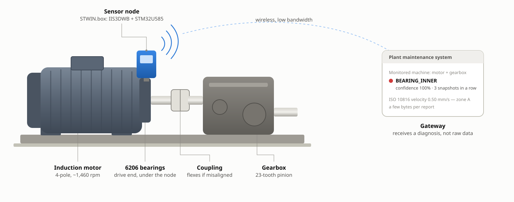
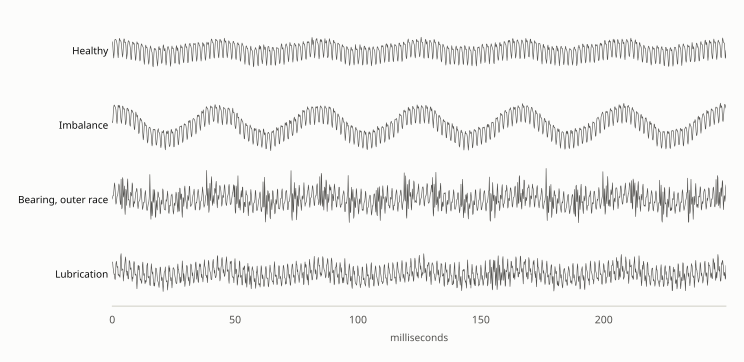
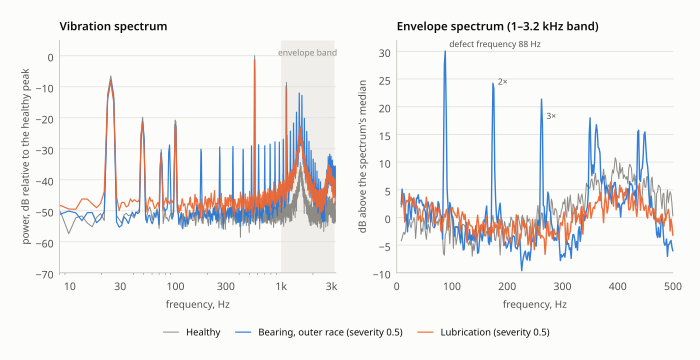
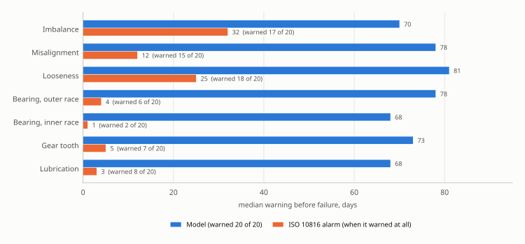
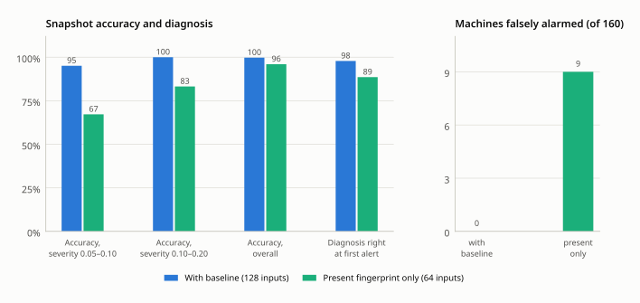

<p align="center">
  
</p>

> **Abstract.** Motors, pumps and gearboxes rarely fail without warning, but the warning is in the *pattern* of their vibration long before it shows in the overall level a traditional alarm watches. This example puts the pattern analysis on the sensor node: every few seconds of accelerometer data becomes a 64-band frequency fingerprint — the vibration spectrum plus the envelope spectrum that reveals bearing and gear impacts — and a 4,792-parameter network compares it with the fingerprint the same machine had when the sensor was installed. On 140 simulated machines run to failure it named the developing fault with a median of 68 to 81 days' warning, against days or nothing for an ISO 10816 vibration alarm on the bearing, gear and lubrication faults, with no false alarms in 5,845 days of healthy running. Training and test data come from a physics-based simulator, and the results should be read as a measure of it, not of a factory floor.

| | |
|---|---|
| **Task** | 8-way classification per snapshot: healthy, or one of seven developing faults; alert after 3 faulty snapshots in a row |
| **Data** | Physics-based simulator of a motor and gearbox (`machine_sim.c`): 400 training machines, every one slightly different; nothing to download |
| **Model** | 64-band spectral fingerprint + change from the machine's own baseline (128 inputs) → FC 32 → FC 16 → softmax 8; 4,792 parameters |
| **Hardware** | STM32U585 (Cortex-M33, 160 MHz) with an IIS3DWB wideband vibration sensor — ST's STWIN.box kit |
| **Result** | 99.75% snapshot accuracy; 68–81 days' median warning before failure on 140 machines; no false alarms in 5,845 healthy machine-days |

## 1. The problem

Motors, pumps, fans, compressors and gearboxes rarely fail without warning. A bearing defect, a loosening mount or a drying lubricant changes how a machine vibrates weeks or months before anything breaks — but in the *pattern* of frequencies first, not the overall level. The traditional vibration monitor watches one number, the RMS vibration velocity of ISO 10816 [1], against a threshold. That number barely moves until damage is advanced, and for bearing, gear and lubrication faults it often moves only in the last few days.

Predictive maintenance closes that gap by analyzing the whole spectrum, and doing it on the sensor node itself pays off in practice. A vibration sensor sampling at kilohertz rates produces megabytes per hour per machine. A plant has hundreds of machines, many of them running on battery-powered or low-bandwidth wireless nodes. A node that reduces each snapshot to "healthy" or "inner-race bearing defect, 100%" sends a few bytes instead, and it keeps working when the network is down.

## 2. The device

<p align="center">
  
</p>
<p align="center"><sub><b>Figure 1.</b> The machine and the node this example targets. The node does all the signal processing and inference itself and reports a diagnosis, not raw vibration. Schematic, not to scale.</sub></p>

| Component | Part | Role |
|---|---|---|
| MCU | **STM32U585** | Cortex-M33 at 160 MHz with single-precision FPU and DSP instructions, 2 MB flash, 786 KB SRAM, low-power modes for battery operation |
| Sensor | **IIS3DWB** | ST's wideband vibration accelerometer: 3-axis, flat frequency response to 6 kHz, fixed 26.667 kHz output data rate. One axis is used; the firmware decimates by 4 to 6.67 kHz |
| Reference hardware | **STWIN.box** (STEVAL-STWBXCORE) | ST's industrial condition-monitoring kit, which pairs exactly these two parts |

Any Cortex-M4F/M7/M33 with ~100 KB of free RAM would do; nothing here is specific to the U5 beyond the compiler flags in the Makefile's `stm32` target.

## 3. The data

There's nothing to download. Public run-to-failure vibration datasets each cover one or two failure modes on one test rig; this example needs seven, at every severity from barely started to about to fail, on many different machines. So `machine_sim.[ch]` synthesizes them: raw acceleration samples, in g, at the rate the firmware reads them, from the physics of each fault's vibration signature.

The simulated machine is a common one: a 4-pole induction motor on 50 Hz mains (running at about 1,460 rpm, or 24.4 Hz, depending on load) driving a gearbox, with 6206 ball bearings. The seven failure modes are the ones listed in the article that motivated this example [2], each with a well-known vibration signature:

| Condition | What's physically happening | Where it shows up in the fingerprint |
|---|---|---|
| `IMBALANCE` | an off-center mass on the rotor | 1× running speed (24 Hz) grows |
| `MISALIGNMENT` | motor and gearbox shafts not collinear; the coupling flexes twice a revolution | 2× and 3× running speed grow |
| `LOOSENESS` | a loose foot or bearing fit; the response clips and rattles | a long comb of harmonics, plus half-orders (12 Hz, 37 Hz, ...) |
| `BEARING_OUTER` | a spall on the outer race; each passing ball strikes it | envelope spectrum: lines at the outer-race defect frequency (3.58×, ~87 Hz) |
| `BEARING_INNER` | a spall on the inner race, rotating in and out of the load zone | envelope spectrum: the inner-race defect frequency (5.42×, ~132 Hz), plus 1× from the modulation |
| `GEAR_TOOTH` | one cracked or chipped tooth on the pinion | sidebands around the gear-mesh frequency (23 teeth × 24 Hz = ~560 Hz); envelope line at 1× |
| `LUBRICATION` | a thinning oil film; metal-to-metal friction | the broadband high-frequency floor rises, with *no* periodicity in the envelope |

No two machines vibrate alike, even two of the same model off the same production line. The simulator varies every one: running speed (motor slip), residual imbalance (a 2.5× range), residual misalignment, gear-mesh level, the frequencies and damping of its structural resonances, noise floor, and sensor mounting gain.

<p align="center">
  
</p>
<p align="center"><sub><b>Figure 2.</b> A quarter-second of raw acceleration from one simulated machine, healthy and with three faults at severity 0.5, all on the same scale — the input the node sees. An imbalance is obvious by eye; the bearing defect shows only as occasional spikes, and poor lubrication as a slightly rougher trace.</sub></p>

## 4. Method

### 4.1 The fingerprint

`vibration_features.[ch]` runs on the device. Each snapshot is 8 frames of 4,096 samples (about 4.9 seconds), and each frame passes through three FFTs (`../../fft.[ch]`):

1. **Vibration spectrum.** Hann window, 4,096-point FFT: 1.63 Hz per bin, 0 to 3.3 kHz. The shaft-rate faults (imbalance, misalignment, looseness), the gear-mesh tone and the friction floor all live here.
2. **Envelope.** A bearing defect makes a tiny impact every time a ball passes over it. Each impact rings the machine's structural resonances at 1–3 kHz, and in the ordinary spectrum that's just a rise in the high-frequency floor, which looks the same as friction from poor lubrication. The information that tells them apart is *how often* the impacts happen. So the same FFT output is band-passed to 1–3.2 kHz with the negative frequencies removed, and an inverse FFT turns it into the analytic signal, whose magnitude is the envelope of the resonance ringing.
3. **Envelope spectrum.** The FFT of that envelope has a line at the impact repetition rate: the outer-race (~87 Hz) or inner-race (~132 Hz) defect frequency, or 1× for a damaged gear tooth that strikes once per revolution. Friction stays flat. This is the classic *envelope analysis* technique of vibration-based condition monitoring [3].

<p align="center">
  
</p>
<p align="center"><sub><b>Figure 3.</b> Why the envelope is needed. In the vibration spectrum (left) a bearing defect and poor lubrication both mostly raise the resonance region. In the envelope spectrum of that region (right) the bearing defect's impacts show as lines at its defect frequency and harmonics; friction has no repetition rate and stays flat. One simulated machine, severity 0.5, computed by <code>vibration_features.c</code>.</sub></p>

The two power spectra are averaged across the 8 frames (Welch's method [4]) and reduced to log energy in logarithmically spaced bands. The vibration spectrum gets 48 bands from 8 Hz to 3.2 kHz: single-bin bands around the shaft harmonics, ~13% wide up by the resonances. The envelope spectrum gets 16 bands from 8 Hz to 500 Hz. Each set is shifted to zero mean, so the sensor's mounting gain cancels out. The result is **64 numbers per snapshot**: the machine's fingerprint. The same pass also produces the ISO 10816 RMS velocity (10 Hz–1 kHz, integrated from the spectrum), which is used only for comparison.

### 4.2 Past and present: the baseline

A machine whose 1× peak is 50% higher than average may be developing an imbalance, or it may simply have been built that way. `health_monitor.[ch]` (also on-device) resolves that the way a vibration analyst would: by comparing the machine with itself. The first 4 snapshots after installation are averaged into a **baseline fingerprint**, 64 floats that the firmware keeps in flash. After that, the model gets 128 inputs: the present fingerprint, and the present fingerprint minus the baseline — how far this machine has moved from its own past. An alert is raised once snapshots have been classified as faulty 3 times in a row, so a single noisy snapshot never sends anyone out to the machine.

<p align="center">
  
</p>
<p align="center"><sub><b>Figure 4.</b> What the network sees: the change in each fingerprint band from one simulated machine's commissioning baseline, for each condition at severity 0.5 (mean of 4 snapshots). Each half of the fingerprint is shifted to zero mean, so energy gained in some bands shows as a small loss in the rest. In brackets, the ISO 10816 velocity of the same snapshots: for the bearing, gear and lubrication faults it hasn't moved from healthy.</sub></p>

`train --present-only` trains the same network on the present fingerprint alone (64 inputs), so what the baseline is worth is measured rather than assumed ([section 5.3](#53-what-the-baseline-is-worth)).

### 4.3 Network

<p align="center">
  
</p>
<p align="center"><sub><b>Figure 5.</b> The pipeline, all of it on the STM32. The baseline (yellow) is captured once, at commissioning, and kept in flash.</sub></p>

| Layer | Type | Output shape | Notes |
|---|---|---|---|
| 0 | Input | 128 | 64-band present fingerprint + 64-band change from the machine's baseline (64 with `--present-only`) |
| 1 | FC | 32 | GELU |
| 2 | FC | 16 | GELU |
| 3 | Output | 8 | Softmax over {HEALTHY, IMBALANCE, MISALIGNMENT, LOOSENESS, BEARING_OUTER, BEARING_INNER, GEAR_TOOTH, LUBRICATION} |

4,792 trainable parameters, one of the simplest networks in this repository's examples, and the reason is worth noting: the hard part — turning 33,000 raw samples into a few dozen numbers that capture what matters — is done by signal processing that's been understood for decades, and the history the problem needs is supplied by the baseline rather than learned by a recurrent layer. What's left for the network is drawing boundaries in a 128-dimensional space that's already well organized.

## 5. Results

Each `test` run simulates machines that weren't in training, so numbers shift by a few percent from run to run, and a separately trained model shifts them a little more; the pattern below holds across repeated runs. [Appendix B](#appendix-b-program-output) has the full output of the run shown.

### 5.1 Snapshot accuracy

On 1,600 snapshots of 100 unseen machines, at fault severities from 0.05 to 1, accuracy is **99.75%** overall. At the earliest severities in the test (0.05–0.10, where the fault's energy is a small fraction of what it will be at failure) it's 95%, and 100% above that.

### 5.2 Run to failure

Run to failure is the result that matters: each simulated machine is commissioned, runs healthy, then develops a fault that grows until it fails on day 120, with one snapshot a day through the firmware's alert logic. A traditional ISO 10816-3 alarm (RMS velocity at or above 2.8 mm/s, held for the same 3 days) watches the same machines on the same days.

<p align="center">
  
</p>
<p align="center"><sub><b>Figure 6.</b> Median warning before failure, 20 simulated machines per fault. The model warned on every machine; the ISO 10816 alarm's median is over the machines it warned on at all, given in brackets.</sub></p>

Over 140 simulated machines run to failure, the model raised an alert on every one, with a median of **68 to 81 days' warning** depending on the fault. It warned at severity 0.03–0.07, the stage where the bearing defect is a pit, not a crater. Its diagnosis at the first alert was right 137 times out of 140. The three misses were adjacent conditions at the very first alert, such as an outer-race bearing defect first called lubrication: at the earliest stage both are mostly a rise in high-frequency energy, and the defect's repetition rate only stands out in the envelope a few days later. The model then corrected itself. Across 5,845 days of healthy running (160 machines), it raised **no false alarms**.

The ISO alarm does reasonably on the faults that raise low-frequency vibration (imbalance, misalignment, looseness), but still weeks later than the model. On the four faults whose early signature is high-frequency or periodic-impact energy, it misses most failures outright and gives a few days' notice on the rest — which matches what condition-monitoring practice says about overall-level alarms and rolling-element bearings.

### 5.3 What the baseline is worth

<p align="center">
  
</p>
<p align="center"><sub><b>Figure 7.</b> The same network trained and tested with the baseline (128 inputs) and on the present fingerprint alone (<code>train --present-only</code>, 64 inputs).</sub></p>

| | With baseline (128 inputs) | Present fingerprint only (64 inputs) |
|---|---|---|
| Snapshot accuracy, overall | 99.75% | 96.00% |
| Snapshot accuracy, severity 0.05–0.10 | 95.1% | 67.2% |
| Snapshot accuracy, severity 0.10–0.20 | 100.0% | 83.2% |
| Diagnosis right at first alert (run to failure) | 137 / 140 | 124 / 140 |
| Median warning, imbalance | 70 days (severity 0.07) | 55 days (severity 0.19) |
| Median warning, lubrication | 68 days (severity 0.05) | 58 days (severity 0.16) |
| False alarms, healthy running | **0** machines | **9 of 160** machines (92 alert-days in 6,051) |

Without the baseline, the model has to decide whether a machine's 1× level or high-frequency floor is abnormal by comparing it with every other machine it trained on. Machines legitimately differ by more than an early fault changes them. So it waits until imbalance and lubrication faults are nearly three times as advanced, confuses looseness with imbalance more often, and occasionally decides a healthy machine with an unusually strong 1× or a lively resonance is faulty — 9 false alarms where the baseline model had none. A false alarm sends a technician to a healthy machine, and after a few of them people start ignoring the alerts, so this is the cost that matters most in practice. Faults that add something new rather than changing the size of something already there — envelope-spectrum lines, half-orders, gear-mesh sidebands — are caught about as early either way.

Comparing a machine's frequency fingerprint now with the one it had when healthy is cheap: 64 floats of flash per machine and one subtraction per input.

## 6. Running on the device

`vibration_features.[ch]`, `health_monitor.[ch]`, `../../fft.[ch]` and `../../nn.[ch]` are the firmware. `train.c`, `test.c` and `monitor.c` call the same functions on the desktop; `machine_sim.[ch]` stands in for the machine and the sensor. `make stm32` compiles the firmware half for the Cortex-M33 (`-mcpu=cortex-m33 -mfpu=fpv5-sp-d16 -mfloat-abi=hard -Os`):

```
   text	   data	    bss	    dec	    hex	filename
    394	      0	      0	    394	    18a	stm32/fft.o
    432	     32	      0	    464	    1d0	stm32/health_monitor.o
  24227	      0	      0	  24227	   5ea3	stm32/nn.o
   1070	      0	      0	   1070	    42e	stm32/vibration_features.o
  26123	     32	      0	  26155	   662b	(TOTALS)
```

Those are object sizes; linking with `--gc-sections` drops the parts of `nn.c` an inference-only device doesn't use (training, model file I/O). The example-specific code is under 2KB.

**Model in flash.** Quantize to int8 and export in the zero-copy inplace format (see the top-level README), then embed it with `xxd -i`:
```
../../quantize model.txt model_q.txt
../../export model_q.txt model_q.inplace --inplace
xxd -i model_q.inplace > model_q_inplace.h
```
That's **5,092 bytes** (19,232 as float32), and `nn_load_model_inplace()` runs it straight out of flash with no RAM copy of the weights. Quantization cost nothing measurable here: `test model_q.inplace` gave 99.81% snapshot accuracy (vs. 99.75% for the float model on a different random draw of test machines), median warnings of 69-85 days, and still no false alarms.

**RAM.** One `health_monitor_t` is about 67KB, almost all of it `vibration_features_t`'s FFT buffers and the two accumulated spectra (4,096 x 3 + 2,049 x 2 floats). Add one frame of samples per DMA buffer (16KB; double-buffered, 32KB) and the network's activations (under 1KB). That's around 100KB of the U585's 786KB. A smaller part would need a smaller FFT (2,048 points halves it, at 3.3Hz resolution) or fixed-point buffers.

**Firmware loop.** `monitor.c`'s main loop is shaped like the firmware's. On the device it becomes:

```c
static health_monitor_t hm;                 // ~67KB, in .bss
nn_t *nn = nn_load_model_inplace(model_q_inplace, model_q_inplace_len);
health_monitor_init(&hm, nn->width[0]);
if (baseline_saved_in_flash())              // commissioned on an earlier boot
  health_monitor_set_baseline(&hm, saved_baseline);
for (;;) {
  sleep_until_next_snapshot();              // e.g. hourly; the MCU and sensor sleep in between
  for (int f = 0; f < VF_FRAMES_PER_SNAPSHOT; f++)
    health_monitor_add_frame(&hm, wait_for_accelerometer_frame()); // IIS3DWB FIFO -> SPI DMA, decimated by 4
  health_report_t report;
  health_monitor_end_snapshot(&hm, nn, &report);
  if (report.commissioning && hm.baseline_snapshots == HM_COMMISSIONING_SNAPSHOTS)
    save_baseline_to_flash(hm.baseline);
  else if (report.alert)
    transmit(report.condition, report.confidence, report.velocity_rms);  // a few bytes
}
```

The three functions not defined in this repository (`wait_for_accelerometer_frame()`, the flash helpers and `transmit()`) are the board-specific parts: the IIS3DWB driver (ST publishes one in its `STMems_Standard_C_drivers` repository), a decimating low-pass filter ahead of `health_monitor_add_frame()` (CMSIS-DSP's `arm_fir_decimate_f32()`), and whatever radio or bus the node reports over.

**Faster FFTs.** `../../fft.c` is portable C. With CMSIS-DSP available, `arm_rfft_fast_f32()` computes the same real-input transform several times faster, and it's a drop-in replacement at `vibration_features.c`'s three call sites. Either way the work runs once per snapshot (24 transforms of 4,096 points every few seconds at most), so for a node that takes one snapshot an hour, speed matters for battery life rather than for keeping up.

This example hasn't been run on hardware; the sizes above come from the cross-compiler.

## 7. Limitations

The numbers above measure a simulator, not a factory floor, and should be read that way:

- **The physics is textbook, and the levels are guesses.** Each fault's signature (which frequencies, which modulation, which resonances) follows the vibration-analysis literature. How strongly a fault shows at a given severity, how noisy real machines are, and the 0-to-1 severity scale itself are this simulator's choices. The size of the gap between the model and the ISO alarm depends on those choices. That a gap exists, and that it's largest for bearing, gear and lubrication faults, is well established in practice.
- **One fault at a time, on one machine type.** Real machines can develop two faults at once (misalignment often causes bearing wear), and other machine types have other speeds, bearings and gear ratios. A model for a different machine needs training on its own fault frequencies, or order-normalized fingerprints (bands at multiples of a measured running speed rather than fixed Hz) to generalize across speeds.
- **The baseline assumes a healthy start.** If a machine is commissioned with a fault already present, the baseline absorbs it. The present-fingerprint half of the input still sees the fault, but only as well as the `--present-only` model does.
- **Real data is the next step.** Public bearing datasets — Case Western Reserve University's seeded-fault data, and the IMS (NASA prognostics repository) and FEMTO/PRONOSTIA run-to-failure sets — cover a subset of these faults on real rigs. Feeding their raw signals (resampled to 6.67kHz) through `vibration_features.[ch]` is the honest test of whether this front end and model carry over.

## Appendix A. Build and run

```
cd examples/predictive_maintenance
make
```

| Command | What it does |
|---|---|
| `./train model.txt` | simulates 400 training and 80 validation machines (20 snapshots each) and trains — under a minute |
| `./test model.txt` | evaluates on 100 more unseen machines, then runs 160 more to failure |
| `./monitor model.txt BEARING_INNER 42` | follows one machine from installation to failure, day by day (any condition name; the optional seed replays the same machine) |
| `./train --present-only model_present.txt` then `./test model_present.txt` | the no-baseline comparison model |
| `make stm32 ARM_CC=/path/to/arm-none-eabi-gcc` | cross-compiles the on-device code for the STM32U585 and reports its size (needs only `arm-none-eabi-gcc` — STM32CubeIDE bundles one) |

The figures in this document are generated by `tools/docs/predictive_maintenance.py`, which runs the example's own simulator and feature extractor.

## Appendix B. Program output

Training log:
```
Simulating 400 training machines and 80 validation machines (20 snapshots each)...
Creating new model.
train error, validation error, learning rate
0.22005, 0.10190, 0.01000
0.09095, 0.06413, 0.01000
0.07137, 0.07678, 0.01000
...
0.00298, 0.01277, 0.01000
No validation improvement for 10 epochs (best: 0.00829) -- stopping early.
Final (last epoch) train error: 0.002981, validation error: 0.012770
Best validation error (the model saved to disk): 0.008295
Validation accuracy (last epoch): 1276/1280 = 99.7%
Training epochs: 54
```

`test model.txt`:
```
Model inputs: present fingerprint + change from baseline

Snapshot accuracy: 100 unseen machines, 16 snapshots each, fault severity 0.05-1.00
Confusion matrix (rows = actual, columns = predicted):
              HEALTH IMBALA MISALI LOOSEN BEARIN BEARIN GEAR_T LUBRIC 
HEALTHY          189      0      0      0      0      0      0      0  (100.0%)
IMBALANCE          0    195      0      0      0      0      0      0  (100.0%)
MISALIGNMENT       0      0    204      0      0      0      0      0  (100.0%)
LOOSENESS          0      0      0    191      0      0      0      0  (100.0%)
BEARING_OUTER      1      0      0      0    210      0      0      0  ( 99.5%)
BEARING_INNER      1      0      0      0      0    217      0      1  ( 99.1%)
GEAR_TOOTH         0      0      0      0      0      0    198      0  (100.0%)
LUBRICATION        1      0      0      0      0      0      0    192  ( 99.5%)
Overall accuracy: 1596/1600 = 99.75%

Fault accuracy by severity (0 = no fault, 1 = failing):
  0.05-0.10:   77/81   =  95.1%
  0.10-0.20:  127/127  = 100.0%
  0.20-0.40:  287/287  = 100.0%
  0.40-0.70:  469/469  = 100.0%
  0.70-1.00:  447/447  = 100.0%

Run to failure: 20 unseen machines per condition, failing on day 120 (onset day 10-40), one snapshot a day.
Warning = days before failure that each alarm first fired (held 3 days, at least a day before failure); ISO alarm = RMS velocity >= 2.8 mm/s.
               NN warned diagnosis  NN median  NN severity   ISO warned   ISO median
                 in time   correct    warning   at warning      in time      warning
IMBALANCE          20/20     20/20    70 days         0.07        17/20      32 days
MISALIGNMENT       20/20     20/20    78 days         0.04        15/20      12 days
LOOSENESS          20/20     20/20    81 days         0.03        18/20      25 days
BEARING_OUTER      20/20     19/20    78 days         0.06         6/20       4 days  (1 first called LUBRICATION)
BEARING_INNER      20/20     19/20    68 days         0.07         2/20       1 days  (1 first called GEAR_TOOTH)
GEAR_TOOTH         20/20     20/20    73 days         0.07         7/20       5 days
LUBRICATION        20/20     19/20    68 days         0.05         8/20       3 days  (1 first called BEARING_INNER)
False alarms (alert raised before any fault existed): 0 of 160 machines, 0 alert-days in 5845 machine-days of healthy running.
```

`monitor model.txt BEARING_INNER 42` — printed weekly, plus every day the model's output or the ISO alarm state changes:
```
Machine (seed 42): BEARING_INNER develops from day 25, fails on day 120.

Commissioned: baseline fingerprint averaged over 4 snapshots.

day  severity  ISO 10816 velocity       model says            model alert
  1     0.000   0.52 mm/s zone A         HEALTHY        100%  
  7     0.000   0.57 mm/s zone A         HEALTHY        100%  
...
 42     0.032   0.53 mm/s zone A         HEALTHY         99%  
 47     0.054   0.50 mm/s zone A         BEARING_INNER   61%  
 49     0.064   0.50 mm/s zone A         BEARING_INNER  100%  ALERT raised
 56     0.106   0.49 mm/s zone A         BEARING_INNER  100%  ALERT
...
105     0.709   0.65 mm/s zone A         BEARING_INNER  100%  ALERT
112     0.839   1.06 mm/s zone A         BEARING_INNER  100%  ALERT
119     0.979   1.79 mm/s zone B         BEARING_INNER  100%  ALERT
120     1.000   2.01 mm/s zone B         BEARING_INNER  100%  ALERT
```

On this machine the inner-race defect was named on day 49, 71 days before failure. The ISO 10816 velocity never left the "acceptable" zones A and B, so a threshold monitor would have stayed silent until the bearing seized.

## References

1. ISO 10816-3, "Mechanical vibration — Evaluation of machine vibration by measurements on non-rotating parts — Part 3: Industrial machines with nominal power above 15 kW," International Organization for Standardization.
2. "[Industrial predictive maintenance maximizes AI at the edge](https://embeddedcomputing.com/technology/ai-machine-learning/predictive-maintenence/industrial-predictive-maintenance-maximizes-ai-at-the-edge)," *Embedded Computing Design*.
3. R. B. Randall and J. Antoni, "Rolling element bearing diagnostics — A tutorial," *Mechanical Systems and Signal Processing*, 2011.
4. P. Welch, "The use of fast Fourier transform for the estimation of power spectra: a method based on time averaging over short, modified periodograms," *IEEE Transactions on Audio and Electroacoustics*, 1967.
