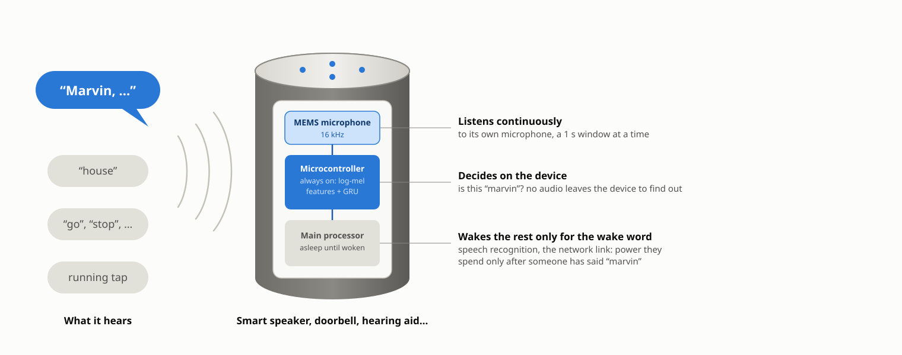
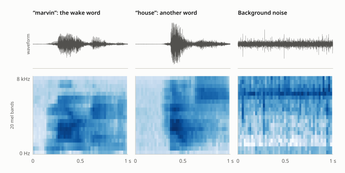
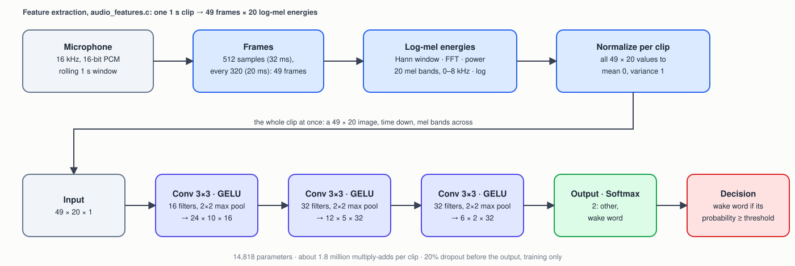
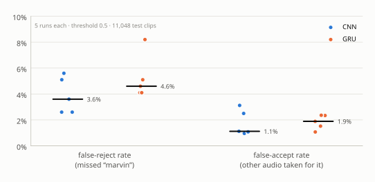

<p align="center">
  
</p>

> **Abstract.** A voice-controlled device has to notice when it's being addressed without streaming its microphone anywhere or keeping a power-hungry speech recognizer awake. This example builds that always-on listener: it turns each second of 16 kHz audio into 49 frames of 20 log-mel energies, normalized per clip, and a 14,818-parameter convolutional network (CNN) reads the whole second as a 49 × 20 image and decides whether it was the wake word, "marvin". It trains and tests on real recordings from Google's Speech Commands dataset, split by speaker with the dataset's own lists, so every test clip is a voice the network never heard. Over five training runs, with the decision threshold set on validation data for at most 1% false accepts, it missed 7.2–8.2% of 195 test "marvin" clips and was falsely triggered by 0.8–1.1% of 10,853 other clips. A GRU on the same data, the recurrent model this example used before, misses 8–17% while triggering on 4–13% of other clips. Quantized to int8 the CNN takes 21 KB of flash and about 78 KiB of RAM, against the GRU's 2 KiB.

| | |
|---|---|
| **Task** | Binary classification of a 1-second audio clip: the wake word "marvin", or anything else |
| **Data** | Google Speech Commands v0.02 (CC BY 4.0), downloaded by the Makefile, split by speaker: training on 1,710 "marvin" clips (plus time-shifted copies) and 9,274 other-word and background-noise clips; testing on 195 "marvin" and 10,853 others from unseen speakers |
| **Model** | 49 × 20 log-mel image → 3 × (3 × 3 conv + 2 × 2 max pool) → softmax 2; 14,818 parameters. Baseline: GRU 32 → sigmoid, 5,121 parameters |
| **Hardware** | An always-on microcontroller with a MEMS microphone, in front of a larger system it wakes; 21 KB of flash and ~78 KiB of RAM for the int8 CNN |
| **Result** | At a threshold set on validation: 7.2–8.2% false rejects at 0.8–1.1% false accepts (5 runs). At 0.5: 4.1–5.6% false rejects, 1.4–3.8% false accepts |

## 1. The problem

A doorbell, a smart speaker or a hearing aid that responds to its name needs something listening all the time. Streaming raw audio to a server to find out whether anyone spoke to it costs bandwidth, power and privacy; keeping a full speech recognizer awake costs power. The usual answer is a *wake-word detector*: a small model on a low-power processor whose only job is deciding, from a rolling one-second window of its own microphone, whether the one word it cares about was just spoken. Only then does it wake everything else.

Two pieces have to work together, and this example keeps them visibly separate:

1. **Feature extraction** (`audio_features.[ch]`, at the repository root) turns a window of raw samples into a short sequence of log-mel energy frames — the same transform full speech recognizers start with. It runs identically on the device, against the live microphone buffer.
2. **The classifier** (this directory's `train_cnn.c`) is a small CNN that reads that whole sequence at once and outputs a wake-word probability. `train_gru.c` trains a recurrent network on the same features as a baseline.

## 2. The device

<p align="center">
  
</p>
<p align="center"><sub><b>Figure 1.</b> Where a wake-word detector sits: between the microphone and everything that costs power. Schematic, not to scale.</sub></p>

`predict.c` shows the split in code: except for loading a WAV file (`wav_reader.[ch]`, which a device doesn't need — it already has samples from its microphone driver), everything it does is what the firmware does.

## 3. The data

The [Speech Commands dataset](https://storage.googleapis.com/download.tensorflow.org/data/speech_commands_v0.02.tar.gz) [1] is tens of thousands of one-second clips of single spoken words from thousands of speakers, recorded on their own devices, plus several minutes of background noise. The positive class is "marvin", one of two words the dataset's authors included to stand in for a wake word. The negative class is every other word, plus one-second stretches of the background-noise recordings, so the model learns to stay quiet through both other speech and ambient noise.

**Split by speaker.** `prepare_data.c` writes `train.csv`, `validation.csv` and `test.csv` directly, following the dataset's own `validation_list.txt` and `testing_list.txt`. Those lists put all of one speaker's clips in the same split, so the test set measures the model on voices it never trained on, which is what a product shipped to new users faces. The background-noise recordings aren't on the lists; each one is split by position, its first 80% to training and the next two 10% stretches to validation and test.

**Training: balanced, and five times larger than it needs to be.** A wake-word detector's hardest job is staying quiet through everything else, so training uses five times as many distinct negatives as a balanced set would, and evens the classes by writing each "marvin" clip once as recorded and four more times shifted by up to ±100 ms. The words in Speech Commands sit wherever the speaker said them within the second, and a live microphone window won't be aligned either. The shift is seeded, so `train.csv` comes out the same on every run.

**Validation and test: everything.** Both get every other-word clip their speakers recorded, about 50 negatives per wake-word clip. A false-accept rate measured on a couple of hundred negatives moves by half a point per clip; measured on 10,000, it can be trusted to a tenth of a point.

| Split | "marvin" | Other words | Background noise | Rows |
|---|---|---|---|---|
| Training | 1,710 clips × 5 = 8,550 | 7,718 | 1,556 overlapping windows | 17,824 |
| Validation | 195 | 9,786 | 39 | 10,020 |
| Test | 195 | 10,810 | 43 | 11,048 |

<p align="center">
  
</p>
<p align="center"><sub><b>Figure 2.</b> Three clips as the network sees them: waveform (top) and the 49 × 20 normalized log-mel features (bottom, darker = more energy). "marvin" and "house" are the same speaker. Normalizing each clip to zero mean and unit variance removes loudness, so even quiet noise fills the scale.</sub></p>

## 4. Method

### 4.1 Features

`audio_features_extract_sequence()` computes, for each one-second clip:

| Step | Setting |
|---|---|
| Frames | 512 samples (32 ms), every 320 samples (20 ms): 49 frames per clip |
| Spectrum | Hann window, 512-point FFT, power |
| Mel filterbank | 20 triangular bands evenly spaced on the mel scale, 0-8 kHz |
| Compression | natural log of each band's energy |
| Normalization | all 980 values of the clip shifted and scaled to mean 0, variance 1 |

Per-clip normalization matters: real recordings vary enormously in loudness and microphone response, and normalizing removes that before the network sees anything.

### 4.2 `train_cnn.c`: the clip as an image

<p align="center">
  
</p>
<p align="center"><sub><b>Figure 3.</b> The pipeline. The CNN reads all 49 frames at once, time down and mel bands across, and decides in one call.</sub></p>

The CSV row `prepare_data.c` writes is frame after frame, which is exactly a 49 × 20 image in row-major order. Convolution learns small time-frequency shapes — the onset of a formant, the band pattern of a voiced syllable — wherever in the second they occur, the way most small keyword-spotting models work [3].

| Layer | Type | Output shape | Notes |
|---|---|---|---|
| 0 | Input | 49 × 20 × 1 | the whole clip: 49 frames (time) × 20 mel bands |
| 1 | CNN | 49 × 20 × 16 | 3 × 3 kernel, 16 filters, "same" padding, GELU |
| 2 | Pool | 24 × 10 × 16 | 2 × 2 max pool, stride 2 |
| 3 | CNN | 24 × 10 × 32 | 3 × 3 kernel, 32 filters, "same" padding, GELU |
| 4 | Pool | 12 × 5 × 32 | 2 × 2 max pool, stride 2 |
| 5 | CNN | 12 × 5 × 32 | 3 × 3 kernel, 32 filters, "same" padding, GELU |
| 6 | Pool | 6 × 2 × 32 | 2 × 2 max pool, stride 2: each value now spans about a quarter of a second |
| 7 | Dropout | 384 | 20%, training only |
| 8 | Output | 2 | Softmax (cross-entropy loss): other, wake word |

14,818 trainable parameters, 14,048 of them in the three convolutions. About 1.8 million multiply-adds per clip, 61% of them in the second convolution.

### 4.3 `train_gru.c`: the recurrent baseline

The baseline reads the same features one 20-value frame per call into a 32-unit GRU [2], whose hidden state carries what it has heard across the clip, and a sigmoid output gives the wake-word probability after the last frame. It has 5,121 parameters and needs far less memory and arithmetic than the CNN (section 6). It is trained the way `examples/gesture_recognition` trains its RNN: every frame of a clip against the clip's label, with plain SGD at 0.03, multiplied by 0.97 each epoch.

### 4.4 Training and testing

`train_cnn` uses plain SGD at a learning rate of 0.002, multiplied by 0.95 each epoch, and stops once validation error hasn't improved for 5 epochs, keeping the best model. Because validation holds about 50 negatives per wake-word clip, both trainers average its error *per class* — the mean over "marvin" clips and the mean over everything else, weighted equally. A plain average would be almost entirely about false accepts, and early stopping would favor a model that rarely fires at all.

`test` scores a model of either kind: the false-reject rate (wake-word clips it missed) and false-accept rate (other clips it fired on) at a chosen threshold, then both rates across thresholds from 0.05 to 0.95. Weight initialization and shuffling aren't seeded, so every training run differs.

## 5. Results

Five runs of each trainer, each tested on the same 11,048 held-out clips from speakers none of the models trained on. Overall accuracy isn't a useful number here — 98% of test clips aren't the wake word, so accuracy is roughly 100% minus the false-accept rate — so the two error rates are reported separately.

### 5.1 At a threshold of 0.5

<p align="center">
  
</p>
<p align="center"><sub><b>Figure 4.</b> Five training runs of each network at the default threshold. Each dot is one run; the bar is the median.</sub></p>

| | CNN (14,818 parameters) | GRU (5,121 parameters) |
|---|---|---|
| False-reject rate (missed "marvin"), median (range) | **4.6%** (4.1–5.6) | 11.8% (8.2–16.9) |
| False-accept rate (other audio taken for it), median (range) | **2.8%** (1.4–3.8) | 9.4% (4.3–13.0) |

The CNN makes less than half the GRU's mistakes of either kind, and its runs land much closer together. Part of the GRU's handicap is the library's: its recurrent layers train with backpropagation through only one timestep (see `LAYER_TYPE_GRU` in `nn.h`), so the GRU can only learn to carry evidence across a clip's 49 frames indirectly. The CNN sees all of them at once.

### 5.2 Choosing the threshold

<p align="center">
  
</p>
<p align="center"><sub><b>Figure 5.</b> The trade-off every wake-word detector makes. Raising the threshold moves each curve up and to the left: fewer false accepts, more missed wake words. The open circles mark 0.5; the diamonds are the five CNN runs at thresholds chosen on validation data.</sub></p>

The threshold decides where on that curve a product sits, and the right point depends on the product: a doorbell can afford a few false wake-ups, a device that starts recording when it wakes can't. With 10,000 validation clips, the threshold can be chosen on validation data and trusted to carry over. For each CNN run, the lowest threshold giving at most 1% false accepts on validation was applied unchanged to the test set:

| Run | Threshold (chosen on validation) | False-reject rate | False-accept rate |
|---|---|---|---|
| 1 | 0.80 | 8.2% | 0.81% |
| 2 | 0.65 | 7.7% | 0.88% |
| 3 | 0.80 | 7.7% | 0.99% |
| 4 | 0.70 | 7.2% | 1.08% |
| 5 | 0.85 | 7.2% | 0.99% |

All five land within a point of each other: **about 8% of wake words missed at 1% false accepts**, on voices the network never heard. The thresholds themselves vary from run to run (0.65–0.85), which is why each model needs its own, set on validation rather than fixed in code. Only one of the five GRU runs gets down to 1% false accepts on validation at any threshold up to 0.95, and at that threshold it misses 45% of the test wake words.

`predict` shows the same decision on single files. With run 4's model, a "marvin" clip scores 0.999 and a "house" clip from the same speaker 0.001.

**An earlier version of this example** used the GRU alone, split the data randomly by clip, and tested on 441 clips, about half of them "marvin". It reported 85% accuracy, with false-reject and false-accept rates of 16% and 14%. A random split puts the same speakers in training and test, so that figure was optimistic; on the speaker split, that same GRU and data scored 82–84%.

## 6. Running on the device

On the device, `audio_features.[ch]` and `../../fft.[ch]` run against the microphone buffer and `nn.[ch]` runs the network; `predict.c` is the same sequence of calls on a WAV file, and `wake_word_probability()` in `wake_word_data.h` runs either model on one window in a single call. A real listener slides the one-second window along the stream rather than waiting for separate clips, and compares the probability against its own threshold (section 5.2).

| Resource | CNN | GRU |
|---|---|---|
| **Flash**, int8, `export --inplace` | **21,300 bytes** | 5,572 bytes |
| **RAM**, model loaded with `nn_load_model_inplace()` | **~78 KiB** | ~1.7 KiB |
| **Compute** per one-second window | ~1.8 million multiply-adds | ~250,000 multiply-adds, over 49 calls |
| Accuracy cost of int8 (run 4, threshold 0.5) | none: 4.1% / 2.09% → 4.1% / 2.03% | none: 16.9% / 4.27% → 16.9% / 4.04% |

Flash and RAM were measured on the quantized, exported models. To build one:

```
../../quantize wake_word_cnn.txt wake_word_cnn_q.txt
../../export wake_word_cnn_q.txt wake_word_cnn.inplace --inplace
./test wake_word_cnn.inplace
```

**RAM is the CNN's larger cost.** A model loaded with `nn_load_model_inplace()` keeps its weights in flash, and its activations in two buffers that every layer shares, each as wide as the widest layer it holds. The first convolution's 49 × 20 × 16 output is four-fifths of the CNN's 78 KiB. That fits a microcontroller with 128 KiB of RAM alongside the audio buffers, though not the smallest always-on parts. Two smaller layouts were measured, five runs each, at the same 1% false-accept operating point:

| Layout | RAM | Flash | False-reject rate at ~1% false accepts, median (range) |
|---|---|---|---|
| This example's CNN | 78 KiB | 21 KB | **7.7%** (7.2–8.2) |
| Stride-2 first convolution, 8 → 16 → 32 filters | 25 KiB | 9.5 KB | 13.3% (8.7–14.9) |
| Stride-2 first convolution, then pooling, 16 → 32 → 32 filters | 21 KiB | 21 KB | 13.3% (7.7–16.4) |

Both cut RAM by two-thirds or more, and both nearly double the missed wake words. Before the library shared activation buffers across layers, the same three layouts needed 251, 77 and 65 KiB.

## 7. Limitations

- **One-second, pre-cut clips.** Every clip is one word within a second of audio. A live microphone stream has words at arbitrary offsets, overlapping speech and long silences; streaming detection needs the window to slide and a rule for not triggering twice on one utterance.
- **False accepts per clip, not per hour.** The negatives are other single words and a few minutes of noise. A product measures false wake-ups per hour of real room audio — television, conversation, music — which this test set doesn't contain.
- **The threshold isn't stored in the model.** `test` and `predict` default to 0.5; the operating point in section 5.2 is chosen per model on `validation.csv` and has to be carried to the firmware separately.
- **Simple augmentation.** Training copies of the wake word are shifted in time only. Mixing background noise into the speech, or varying its volume and pitch, are the usual next steps.
- **Small model, small data.** 1,710 training examples of the wake word; production wake-word models train on far more, from far more speakers.

## Appendix A. Build and run

```
cd examples/wake_word_detection
make
```

The first `make` downloads and extracts the ~2.4 GB Speech Commands archive, builds `prepare_data` and runs it (about 15 seconds) to write `train.csv`, `validation.csv` and `test.csv` (~170, ~95 and ~105 MB), and builds `train_cnn`, `train_gru`, `test` and `predict`. `make clean` keeps the dataset; `make distclean` removes it.

| Command | What it does |
|---|---|
| `./train_cnn wake_word_cnn.txt` | trains the CNN (about 13 minutes for 11 epochs, single-threaded; resumes if the file exists) |
| `./train_gru wake_word_gru.txt` | trains the GRU baseline; use a different model file than the CNN's |
| `./test wake_word_cnn.txt validation.csv` | false-reject and false-accept rates across thresholds on the validation set: choose the threshold here |
| `./test wake_word_cnn.txt test.csv 0.7` | both rates on the test set at the chosen threshold (either model; the defaults are `test.csv` and 0.5) |
| `./predict wake_word_cnn.txt dataset/marvin/<file>.wav` | the wake-word probability of one WAV file, the way an application would get it |
| `./prepare_data dataset sheila` | rebuilds all three CSVs for a different wake word; then train a new model |

The figures in this document are generated by `tools/docs/wake_word_detection.py`.

## Appendix B. Program output

`./train_cnn wake_word_cnn.txt` (run 4 of the five in section 5; the validation error is the per-class average of section 4.4):

```
Creating new model.
train error, validation error, learning rate
0.35302, 0.25083, 0.00200
0.14810, 0.16286, 0.00190
0.10105, 0.14824, 0.00181
0.07389, 0.16773, 0.00171
0.05716, 0.12874, 0.00163
0.04967, 0.10298, 0.00155
0.04085, 0.11556, 0.00147
0.03585, 0.10505, 0.00140
0.03215, 0.12188, 0.00133
0.03017, 0.11139, 0.00126
0.02422, 0.16655, 0.00120
No validation improvement for 5 epochs (best: 0.10298) -- stopping early.
Final (last epoch) train error: 0.024218, validation error: 0.166550
Best validation error (the model saved to disk): 0.102979
Training epochs: 11
```

`./test wake_word_cnn.txt validation.csv`, the rows around 1% false accepts (the lowest threshold at or under it is 0.70):

```
threshold, false-reject %, false-accept %
...
0.60, 6.2, 1.50
0.65, 6.2, 1.19
0.70, 6.7, 0.98
...
```

`./test wake_word_cnn.txt test.csv 0.7`:

```
test.csv: 11048 clips (195 wake word, 10853 other), threshold 0.70
Accuracy: 10917/11048 = 98.81%
False-reject rate (missed wake word): 14/195 = 7.2%
False-accept rate (wrongly triggered): 117/10853 = 1.08%

threshold, false-reject %, false-accept %
0.05, 1.5, 11.14
0.10, 1.5, 7.59
0.15, 2.1, 5.88
0.20, 2.1, 4.99
0.25, 2.1, 4.22
0.30, 2.6, 3.57
0.35, 3.1, 3.05
0.40, 3.6, 2.70
0.45, 3.6, 2.43
0.50, 4.1, 2.09
0.55, 4.6, 1.78
0.60, 5.6, 1.50
0.65, 6.2, 1.32
0.70, 7.2, 1.08
0.75, 8.7, 0.92
0.80, 9.7, 0.67
0.85, 10.3, 0.49
0.90, 13.3, 0.39
0.95, 16.9, 0.14
```

`./predict wake_word_cnn.txt` on a "marvin" clip and a "house" clip from the same speaker:

```
$ ./predict wake_word_cnn.txt dataset/marvin/00b01445_nohash_0.wav
Wake-word probability: 0.99917
$ ./predict wake_word_cnn.txt dataset/house/00b01445_nohash_0.wav
Wake-word probability: 0.00118
```

## References

1. P. Warden, "[Speech Commands: a dataset for limited-vocabulary speech recognition](https://arxiv.org/abs/1804.03209)," arXiv:1804.03209, 2018.
2. K. Cho et al., "Learning phrase representations using RNN encoder-decoder for statistical machine translation," *EMNLP*, 2014 (the GRU).
3. T. N. Sainath and C. Parada, "Convolutional neural networks for small-footprint keyword spotting," *Interspeech*, 2015.
